# Лабораторна робота №3: Розгортання власного застосунку в Kubernetes

**Дисципліна:** Технології DevOps  
**Студент:** Короленко Влад Романович (`vlkorolenko`)  
**Проєкт:** `DevOps TechStore` (`product-service`, `order-service`, `frontend`, `postgres`)  
**Кластер:** Локальний кластер **Minikube v1.39.0** (`driver=docker`, Kubernetes `v1.37.0`)  
**Простір імен:** `devops-techstore`  
**Звіти зі скріншотами:** [`LAB3_REPORT.pdf`](LAB3_REPORT.pdf) · [`LAB3_REPORT.docx`](LAB3_REPORT.docx) · [`docs/screenshots/`](docs/screenshots/)

---

## 📋 Зміст (відповідність кожному пункту і підпункту завдання)

| Пункт | Підпункти | Стан |
|------|-----------|------|
| **1. Підготувати образ застосунку** | `1a` Dockerfiles · `1b` GHCR + Minikube · `1c` Конкретні теги без `latest` · `1d` Дві версії (`1.0.0`, `1.1.0`) | ✅ Виконано |
| **2. Розгорнути локальний кластер** | `2a` `minikube` & `kubectl` · `2b` `driver=docker` · `2c` Node & `kube-system` · `2d` `metrics-server` & `ingress` | ✅ Виконано |
| **3. Окремий namespace** | `3a` `devops-techstore` · `3b` Ізоляція всіх об'єктів у цьому namespace | ✅ Виконано |
| **4. Описати маніфести (`k8s/`)** | `4a` 1 файл = 1 об'єкт · `4b` Deployment · `4c` Service · `4d` ConfigMap · `4e` Secret · `4f` Ingress · `4g` PVC | ✅ Виконано |
| **5. Розгорнути застосунок** | `5a` 1 команда `kubectl apply` · `5b` Об'єкти + метрики · `5c` Браузер UI + БД · `5d` ConfigMap/Secret у подах | ✅ Виконано |
| **6. Керування життєвим циклом** | `6a` Self-healing · `6b` Масштабування (4) + балансування · `6c` Rolling Update · `6d` History & Rollback · `6e` Без простою | ✅ Виконано |
| **7. Виконати діагностику** | `7a` `ImagePullBackOff` · `7b` `describe` Events · `7c` `logs` & `exec -it` · `7d` Виправлення та відновлення | ✅ Виконано |
| **8. Оформити результати** | `8a` Коміти `k8s/` у Git · `8b` `README.md` (порядок + ConfigMap/Secret) · `8c` Звіт зі скріншотами | ✅ Виконано |

---

## 1. Підготувати образ застосунку

### 1a) Використати образ власного проєкту, зібраний у попередніх лабораторних
Використано власні `Dockerfile` мікросервісів `product-service`, `order-service` та `frontend` із Лабораторних №1–2 із підтримкою аргументу збірки `APP_VERSION`.

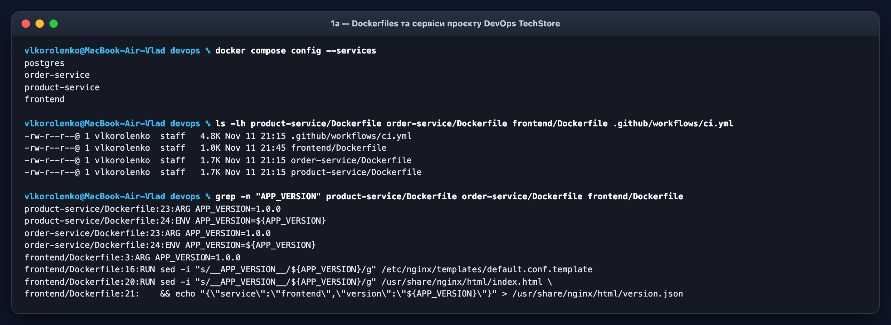

### 1b) Образ має бути опублікований у registry (GHCR або локально завантажений у minikube)
Образи зібрані CI/CD пайплайном [`.github/workflows/ci.yml`](.github/workflows/ci.yml) (multi-arch `linux/amd64`, `linux/arm64`), опубліковані в **GHCR** (`ghcr.io/vlkorolenko/devops-lab1/*`) та завантажені в **Minikube**.

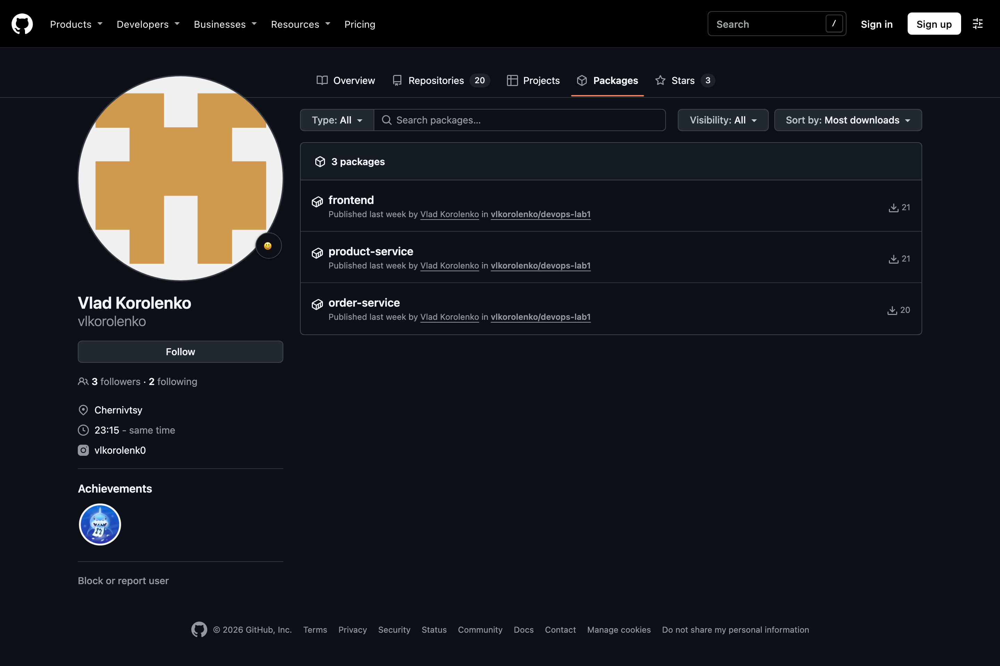

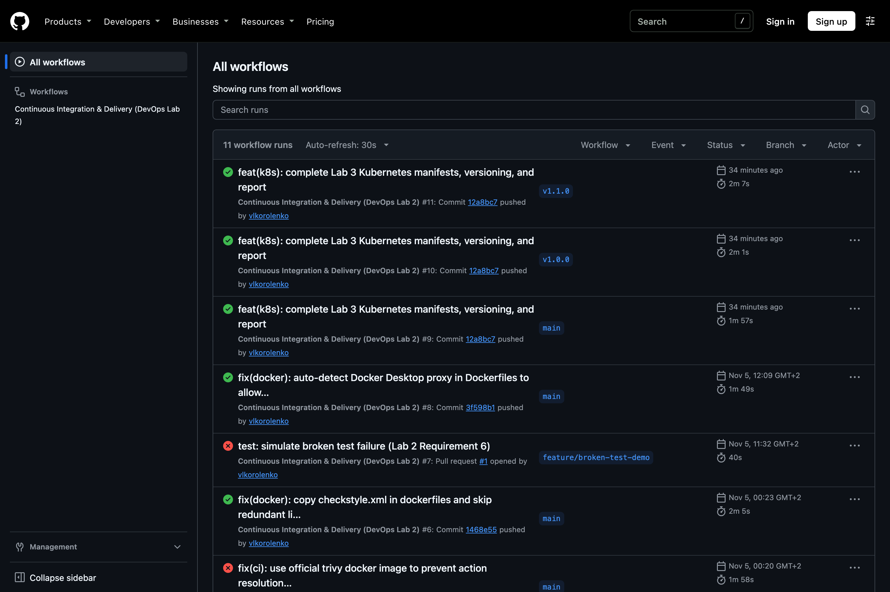

### 1c) Образ позначити конкретним тегом версії, тег `latest` не використовувати
У всіх YAML-маніфестах каталогу [`k8s/`](k8s/) вказані конкретні версії (`:1.0.0`, `postgres:16-alpine`), тег `:latest` не використовується.

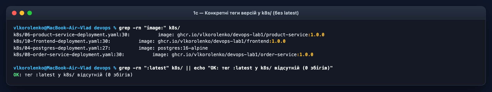

### 1d) Підготувати щонайменше дві версії образу (`1.0.0` і `1.1.0`)
Підготовлено версії `1.0.0` та `1.1.0` (Git-теги `v1.0.0` і `v1.1.0`, образи в GHCR і локально в Minikube).

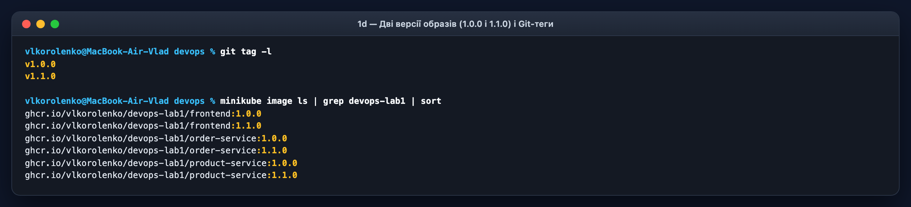

---

## 2. Розгорнути локальний кластер

### 2a) Встановити `minikube` та `kubectl`
Встановлено утиліти `minikube v1.39.0` та `kubectl v1.37.2`.

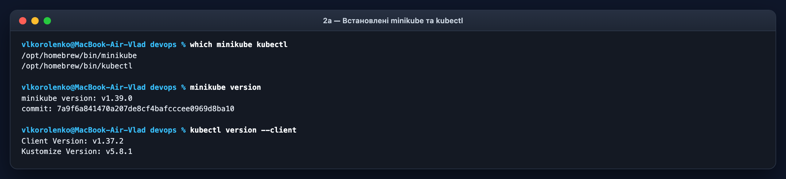

### 2b) Запустити кластер з драйвером `docker`
Кластер `minikube` (`v1.37.0`) працює на драйвері `docker` (`containerd`).

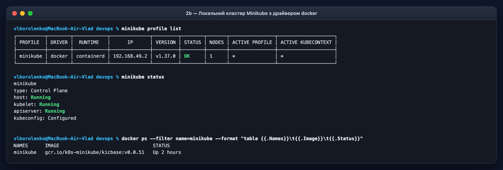

### 2c) Перевірити стан вузла та системних подів у namespace `kube-system`
Нода `minikube` у статусі `Ready`, усі поди `kube-system` у статусі `Running`.

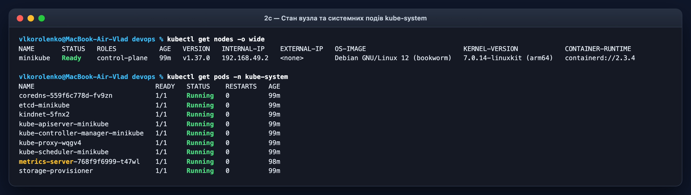

### 2d) Увімкнути доповнення `metrics-server` та `ingress`
Обидва доповнення активовані, контролер `ingress-nginx` працює, `kubectl top nodes` повертає метрики.

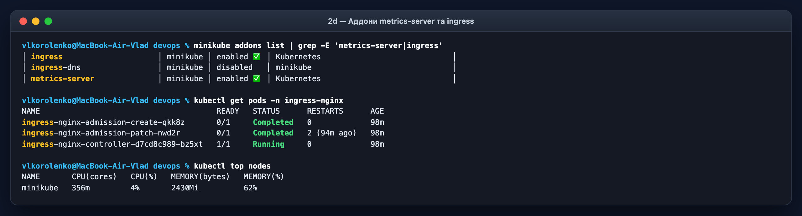

---

## 3. Створити окремий namespace для проєкту

### 3a) Namespace назвати за іменем проєкту або прізвищем студента
У файлі [`k8s/00-namespace.yaml`](k8s/00-namespace.yaml) визначено окремий простір імен `devops-techstore`.

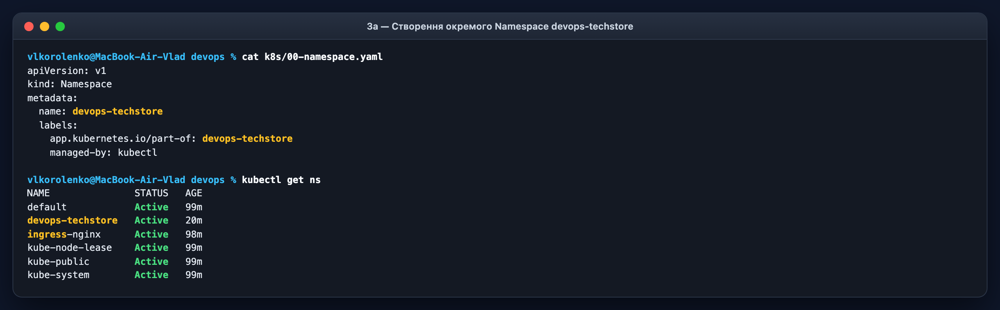

### 3b) Усі подальші об'єкти створювати лише в цьому namespace
У кожному маніфесті `k8s/` прописано `namespace: devops-techstore`, і всі об'єкти розгортаються виключно в ньому.

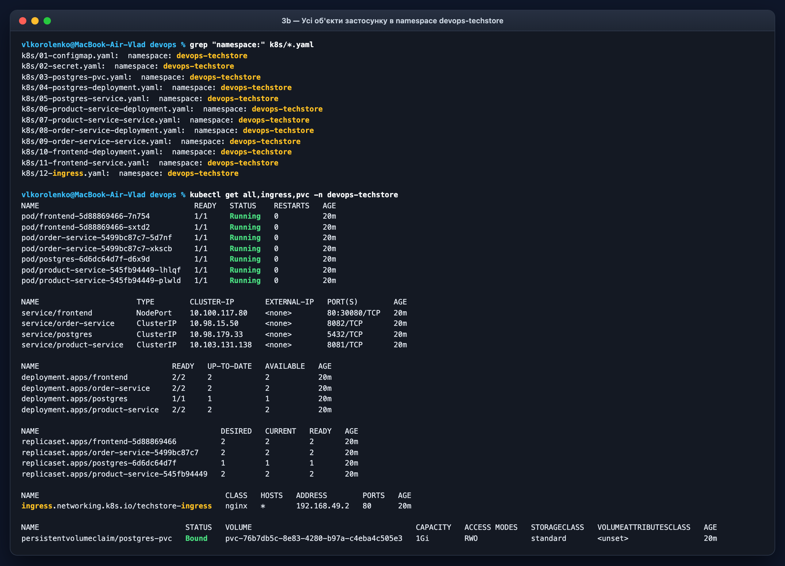

---

## 4. Описати маніфести застосунку

### 4a) Усі маніфести зберігати в каталозі `k8s/` у репозиторії проєкту, по одному файлу на об'єкт
У каталозі [`k8s/`](k8s/) створено 13 ручних YAML-маніфестів за правилом «один файл — один об'єкт».

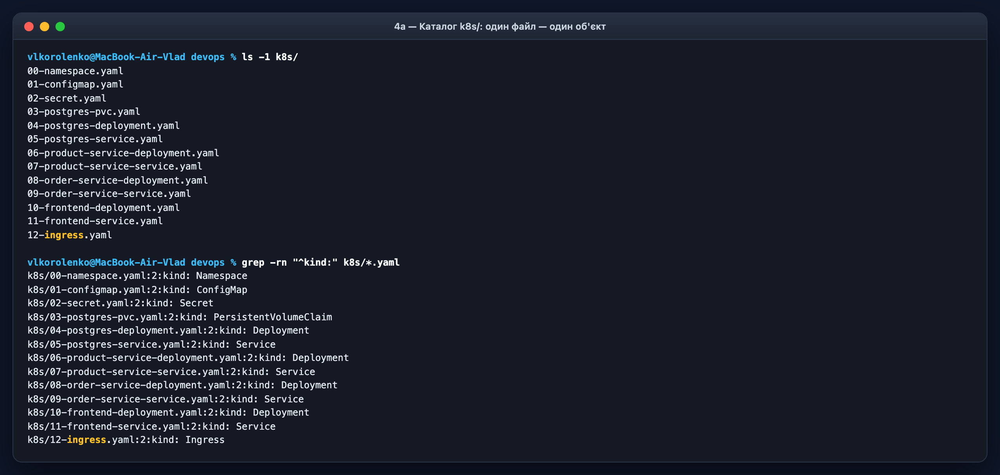

### 4b) `Deployment`: ≥ 2 репліки, узгоджені `labels` і `selector`, `requests/limits`, `liveness`/`readiness`-проби
Сервіси `product-service`, `order-service`, `frontend` описані з `replicas: 2`, узгодженими `matchLabels` та `labels`, ресурсами `requests/limits` і HTTP-пробами.

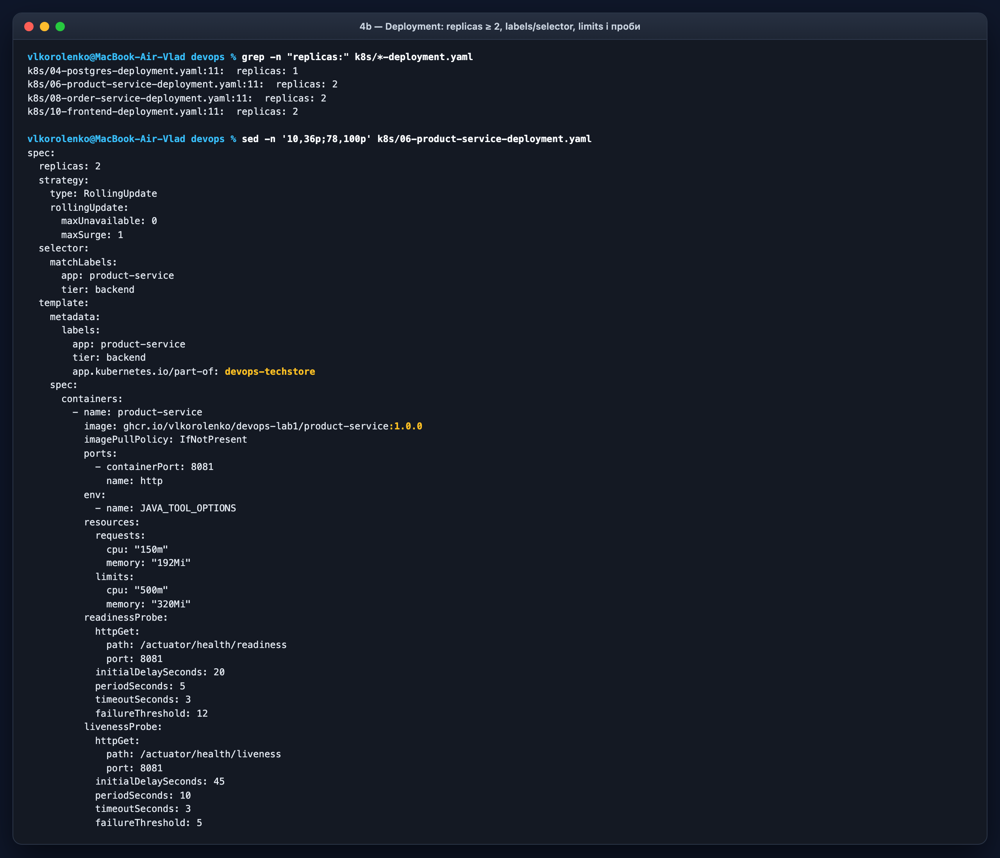

### 4c) `Service`: тип для доступу всередині кластера та з хоста
Внутрішні мікросервіси та БД мають тип `ClusterIP`, а `frontend` — `NodePort` (`80:30080/TCP`).

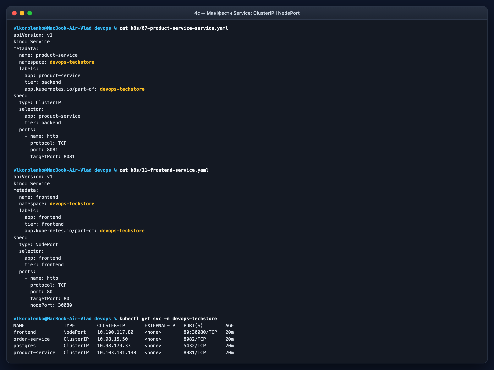

### 4d) `ConfigMap`: щонайменше два параметри конфігурації (змінні оточення або файл)
У [`k8s/01-configmap.yaml`](k8s/01-configmap.yaml) налаштовано 7 змінних оточення (`configMapKeyRef`) та файл `store-config.json` (монтується через `volumeMounts` у `frontend`).

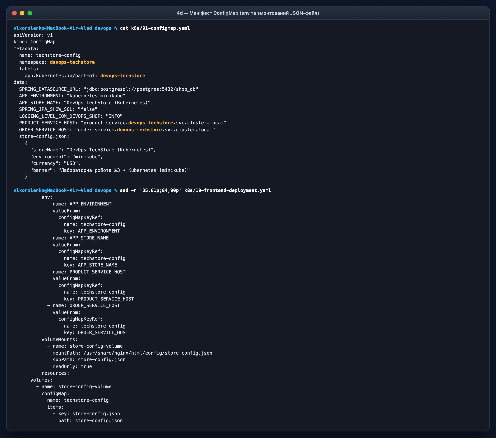

### 4e) `Secret`: щонайменше один чутливий параметр
У [`k8s/02-secret.yaml`](k8s/02-secret.yaml) задано тестові паролі БД та ключ `INTERNAL_API_KEY`, підключені через `secretKeyRef`.

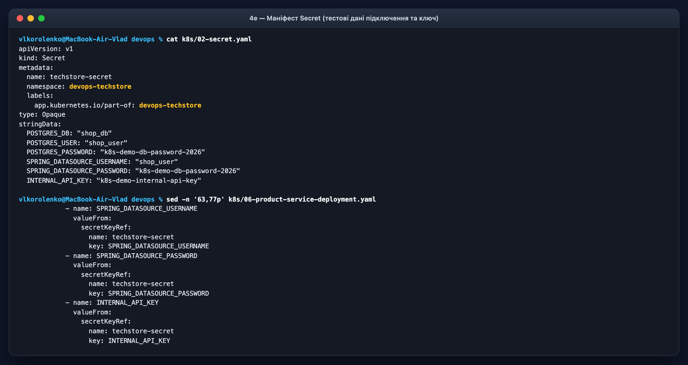

### 4f) `Ingress` для зовнішнього HTTP-доступу
У [`k8s/12-ingress.yaml`](k8s/12-ingress.yaml) описано `Ingress` класу `nginx`, що направляє запити `/` на сервіс `frontend`.

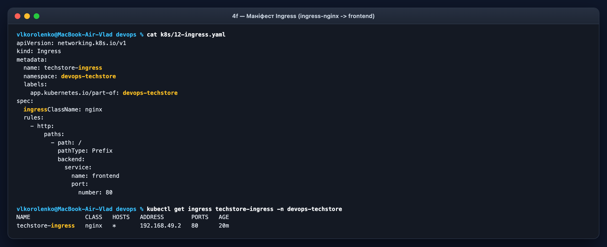

### 4g) `PersistentVolumeClaim` для компоненту зі станом (`postgres`)
У [`k8s/03-postgres-pvc.yaml`](k8s/03-postgres-pvc.yaml) створено том `postgres-pvc` (`1Gi`, `ReadWriteOnce`), підключений у [`k8s/04-postgres-deployment.yaml`](k8s/04-postgres-deployment.yaml).

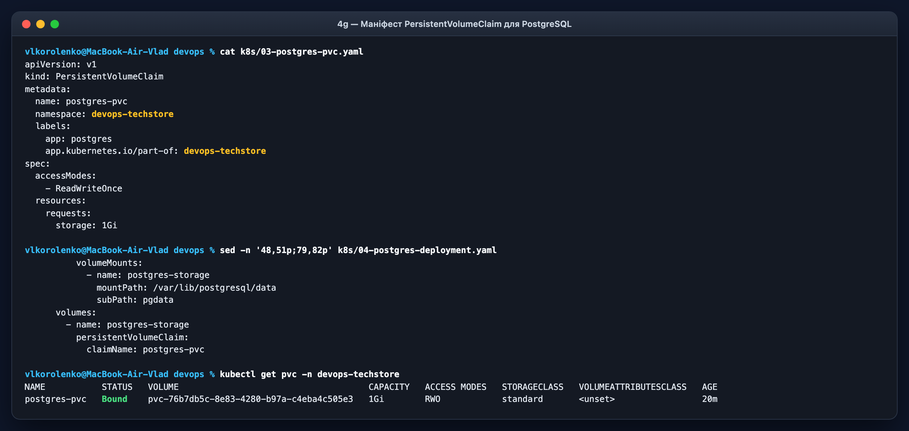

---

## 5. Розгорнути застосунок

### 5a) Застосувати всі маніфести однією командою з каталогу
Весь застосунок розгорнуто з нуля однією командою `kubectl apply -f k8s/`.

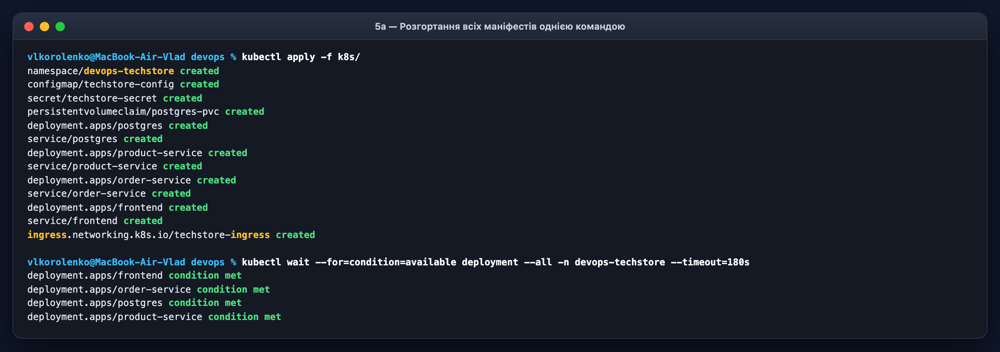

### 5b) Показати перелік створених об'єктів: поди, `Deployment`, `ReplicaSet`, `Service`
Усі 7 подів, 4 Deployments, 4 ReplicaSets, 4 Services та метрики `kubectl top pods` у справному стані.

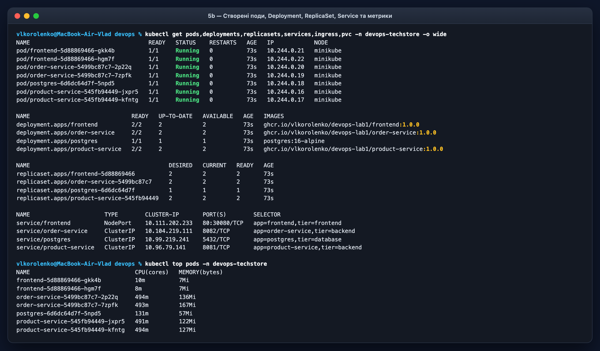

### 5c) Відкрити застосунок у браузері та показати, що він працює
Застосунок відкрито в браузері Google Chrome через Ingress: завантажуються 6 товарів із PostgreSQL, банер із `ConfigMap`, ім'я пода та оформлення замовлення #1.

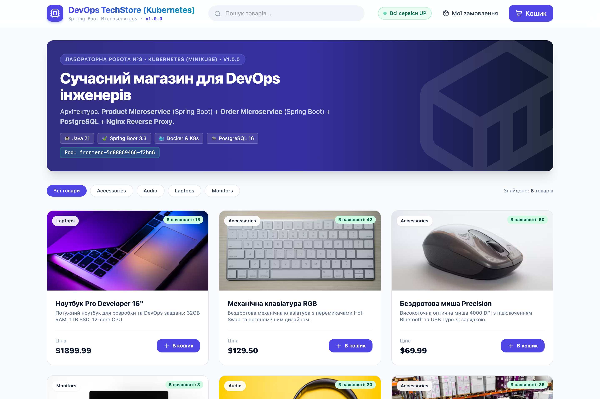

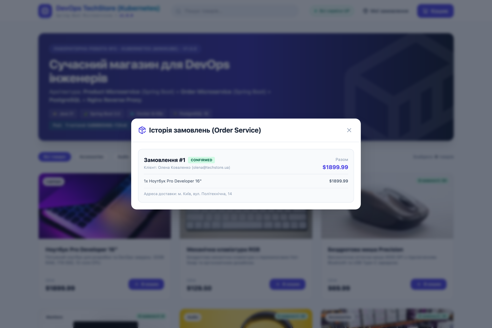

### 5d) Показати, що значення з `ConfigMap` і `Secret` справді потрапили в контейнер
Перевірено змінні оточення через `kubectl exec ... -- env`, вміст `/usr/share/nginx/html/config/store-config.json` та `/actuator/product-service/info`.

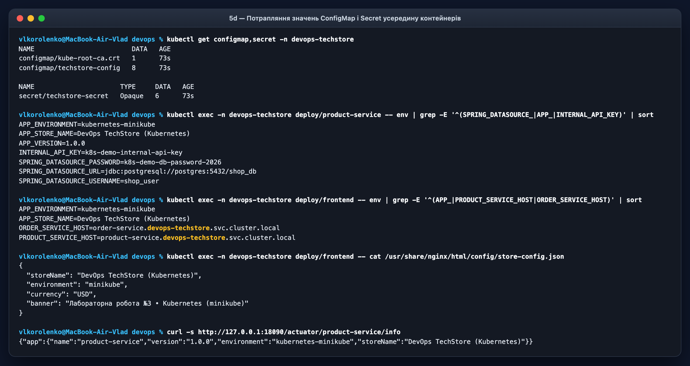

---

## 6. Продемонструвати керування життєвим циклом

### 6a) Самовідновлення: видалити под і показати, що кластер створив новий
Після видалення одного з подів `frontend` контролер `ReplicaSet` миттєво створив новий под (`2/2 Running`).

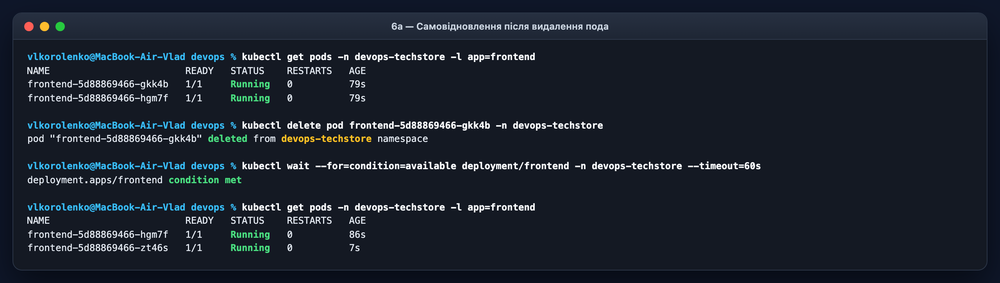

### 6b) Масштабування: збільшити кількість реплік і показати розподіл трафіку між ними
Масштабування `frontend` з 2 до 4 реплік та розподіл 20 запитів між усіма 4 подами на `NodePort` та `Ingress`.

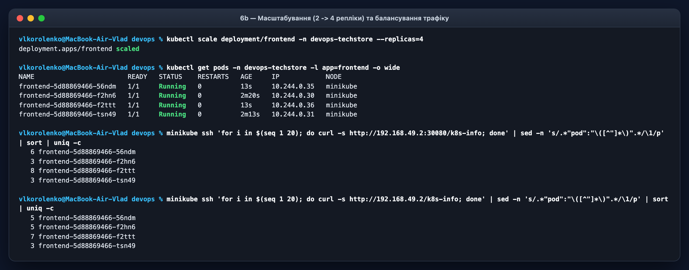

### 6c) Оновлення: замінити образ на другу версію (`1.1.0`) та показати процес `rolling update`
Оновлення `frontend` та `product-service` з `1.0.0` на `1.1.0` зі стратегією `RollingUpdate` і перевірка нової версії в API та браузері.

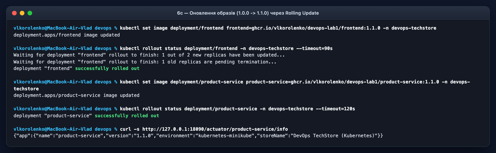

### 6d) Історія оновлень та відкат до попередньої ревізії
Перевірка історії (`kubectl rollout history`) та повернення попередньої версії `1.0.0` командою `kubectl rollout undo`.

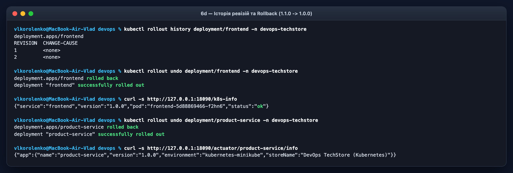

### 6e) Показати, що під час оновлення застосунок залишався доступним
Паралельний HTTP-зонд зафіксував `33/33 HTTP 200 OK` (`Failures=0`) при переході з `1.0.0` на `1.1.0`.

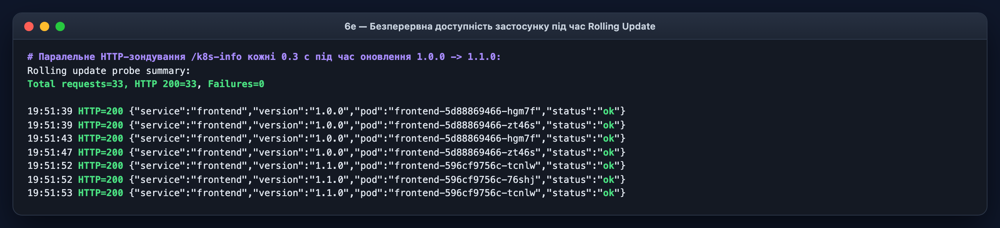

---

## 7. Виконати діагностику

### 7a) Навмисно вказати неіснуючий тег образу і показати стан `ImagePullBackOff`
При встановленні тегу `frontend:9.9.9-nonexistent` новий под переходить у статус `ImagePullBackOff`, водночас старі репліки обслуговують запити.

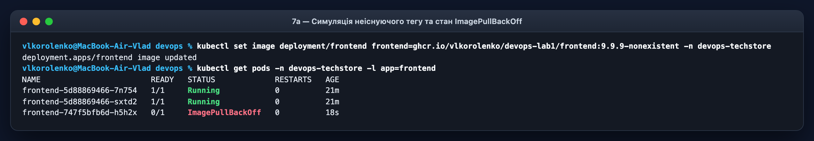

### 7b) Знайти причину за допомогою опису пода та подій (`Events`)
Через `kubectl describe pod` у секції `Events` знайдено точну помилку (`not found`, `ErrImagePull`, `ImagePullBackOff`).

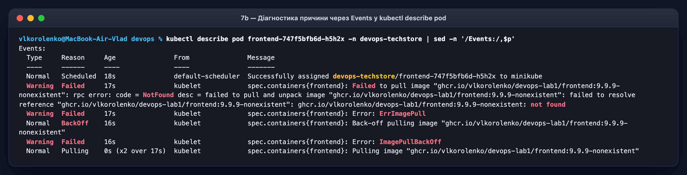

### 7c) Показати логи контейнера та вхід у контейнер в інтерактивному режимі
Перевірено логи бекенду (`kubectl logs`) та інтерактивний вхід у контейнер `frontend` (`kubectl exec -it ... -- sh`).

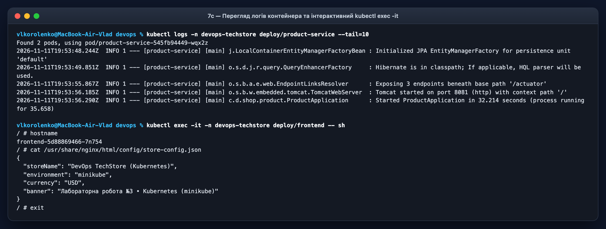

### 7d) Виправити помилку і довести застосунок до робочого стану
Виправлено тег на `:1.0.0`; усі 7 подів і 4 Deployments успішно повернулись у стан `Running` (`RESTARTS: 0`).

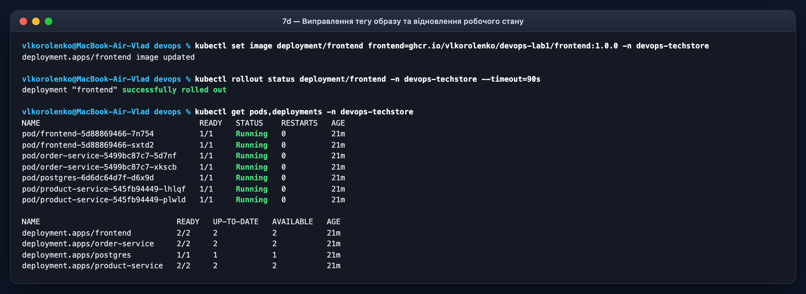

---

## 8. Оформити результати

### 8a) Каталог `k8s/` з маніфестами закомітити в репозиторій проєкту
Усі 13 маніфестів [`k8s/`](k8s/) закомічено в гілку `main` репозиторію `vlkorolenko/devops-lab1`.

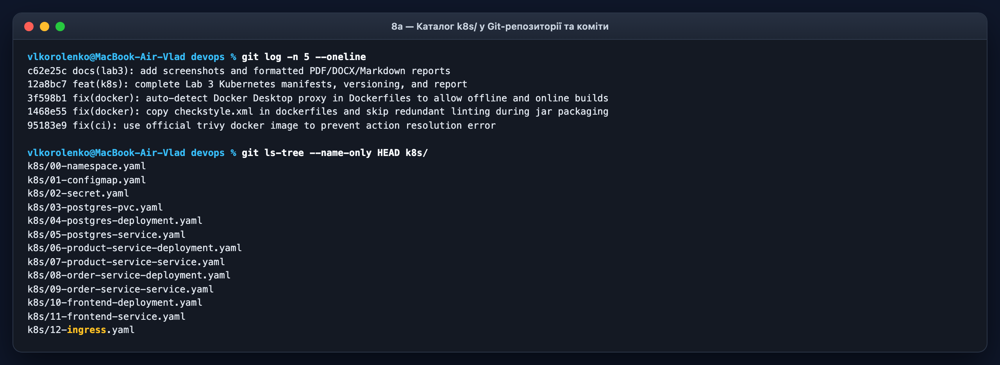

### 8b) У `README` описати порядок розгортання та перелік параметрів у `ConfigMap` і `Secret`
У [`README.md`](README.md) наведено таблицю параметрів `ConfigMap`/`Secret` та покрокові команди розгортання з нуля.

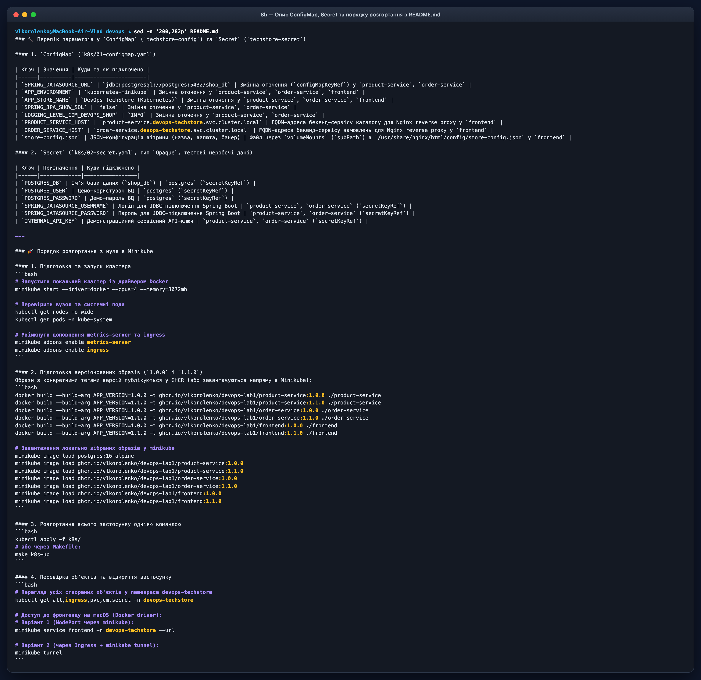

### 8c) Підготувати короткий звіт зі скріншотами або збереженим виводом команд
Підготовлено деталізований звіт по кожному пункту й підпункту у форматах [`LAB3_REPORT.md`](LAB3_REPORT.md), [`LAB3_REPORT.docx`](LAB3_REPORT.docx) та [`LAB3_REPORT.pdf`](LAB3_REPORT.pdf).

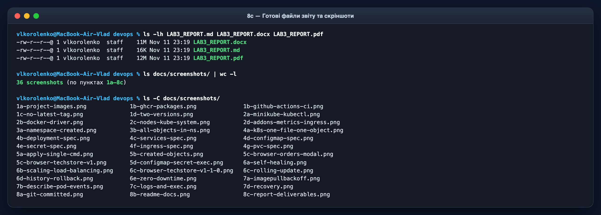
