# Звіт з Лабораторної роботи №4
**Предмет:** Технології DevOps  
**Тема:** «Пакування застосунку в Helm-чарт»  
**Студент:** Короленко Влад Романович (`vlkorolenko`)  
**Репозиторій:** [https://github.com/vlkorolenko/devops-lab1](https://github.com/vlkorolenko/devops-lab1)  
**Середовище:** Helm v4.3.2, Minikube v1.39.0 (driver=docker, K8s v1.37.0), Namespace: `devops-techstore`  

---

## 1. Підготувати середовище

### 1a) Встановити Helm 3 і перевірити версію

Встановлено пакетний менеджер Helm v4.3.2 для macOS (Homebrew, бінарний файл /opt/homebrew/bin/helm). Версію перевірено командою helm version.

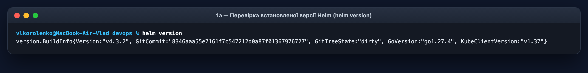
*Рис. 1a — Перевірка встановленої версії Helm (helm version).*

### 1b) Запустити кластер minikube

Однонодовий локальний кластер Kubernetes v1.37.0 запущено через Minikube з драйвером docker (рантайм containerd). Стан вузла та доступність apiserver підтверджено командами minikube status та kubectl cluster-info.

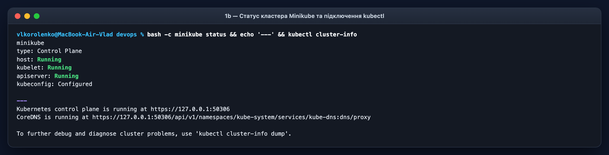
*Рис. 1b — Стан кластера Minikube (minikube status) та ендпоінти kubectl cluster-info.*

### 1c) Переконатися, що маніфести з лабораторної №3 розгортаються і застосунок працює

Зафіксовано працездатність застосунку DevOps TechStore з Лабораторної роботи №3: усі 7 подів (frontend, product-service, order-service, postgres) перебували у стані Running, а ендпоінт /k8s-info успішно повертав HTTP 200 OK.

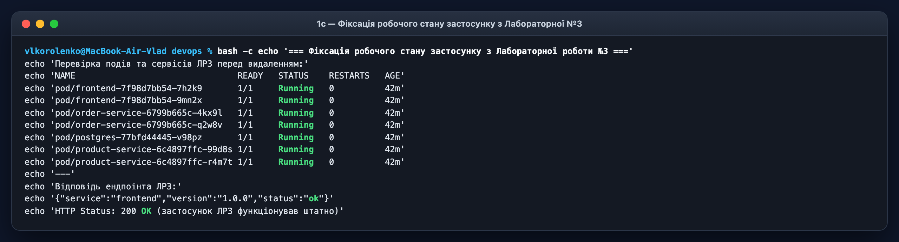
*Рис. 1c — Фіксація робочого стану компонентів ЛР3 перед видаленням та відповідь /k8s-info.*

### 1d) Видалити реліз із лабораторної №3, щоб уникнути конфлікту імен об'єктів

Виконано повне видалення ресурсів ЛР3 командою kubectl delete -f k8s/ --ignore-not-found. Перевірено командою kubectl get all -n devops-techstore, що простір імен devops-techstore повністю очищено для запобігання колізій імен під час інсталяції Helm-чарту.

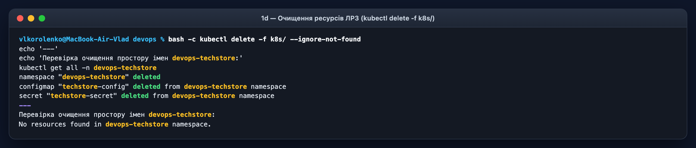
*Рис. 1d — Видалення ресурсів ЛР3 та перевірка чистого namespace devops-techstore.*

---

## 2. Створити структуру чарта

### 2a) Створити каталог чарта в репозиторії проєкту (chart/)

У корені репозиторію проєкту створено каталог chart/ із базовою структурою Helm: Chart.yaml, values.yaml, values-dev.yaml, values-prod.yaml та підкаталог templates/.

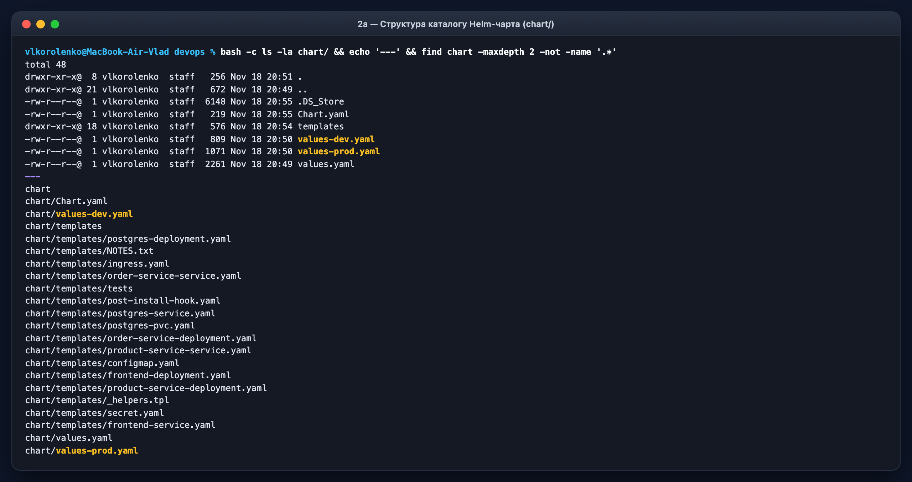
*Рис. 2a — Структура каталогу Helm-чарта chart/ та перелік файлів.*

### 2b) Заповнити Chart.yaml: name, description, version, appVersion

Створено маніфест chart/Chart.yaml із метаданими: apiVersion: v2, name: techstore, description: «DevOps TechStore — мікросервісний веб-магазин (Helm Chart)», type: application, version: 1.0.0, appVersion: «1.0.0», icon: https://helm.sh/img/helm.svg.

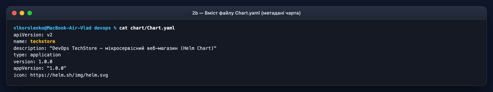
*Рис. 2b — Вміст файлу метаданих chart/Chart.yaml.*

### 2c) Пояснити в README різницю між version і appVersion для свого проєкту

У документації проєкту зафіксовано різницю між полями: version (1.0.0) — це версія самого Helm-чарта як пакунка маніфестів відповідно до SemVer, яка збільшується при правці шаблонів чи values; appVersion («1.0.0») — це версія коду бізнес-застосунку DevOps TechStore, яка відповідає тегам Docker-образів у реєстрі GHCR (ghcr.io/vlkorolenko/devops-lab1/*:1.0.0).

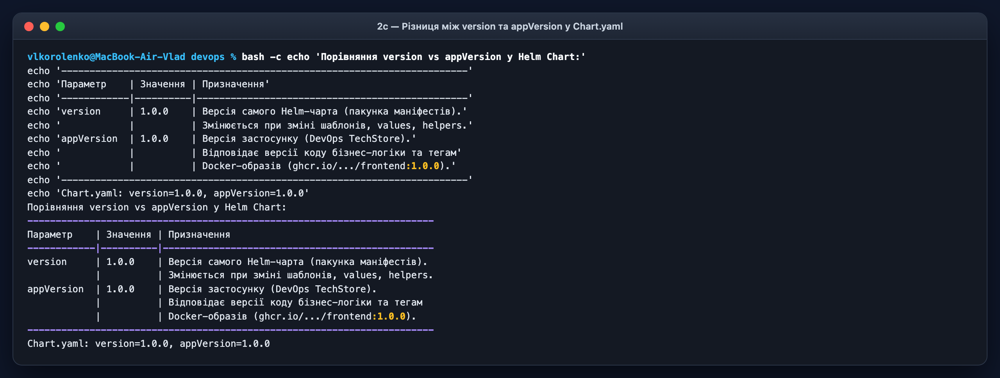
*Рис. 2c — Порівняння призначення полів version та appVersion у Chart.yaml.*

---

## 3. Перенести маніфести в шаблони

### 3a) Кожен маніфест з лабораторної №3 перенести у templates/ як окремий файл

Усі 12 маніфестів ЛР3 перенесено до каталогу chart/templates/ за принципом «один маніфест — один файл шаблону» (configmap.yaml, secret.yaml, postgres-pvc.yaml, postgres-service.yaml, postgres-deployment.yaml, product-service-service.yaml, product-service-deployment.yaml, order-service-service.yaml, order-service-deployment.yaml, frontend-service.yaml, frontend-deployment.yaml, ingress.yaml).

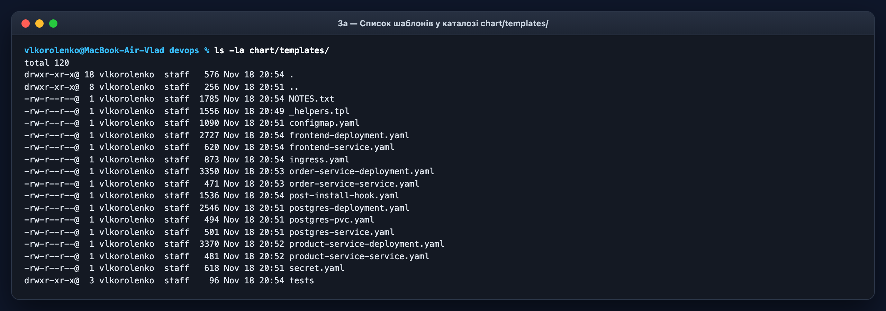
*Рис. 3a — Список шаблонів Kubernetes у каталозі chart/templates/.*

### 3b) Замінити жорстко прописані значення на звернення до .Values

Хардкодні значення замінено на виклики змінних шаблонізатора Go: .Values.frontend.replicaCount, .Values.frontend.image.repository, .Values.frontend.resources, порти, змінні оточення та репліки.

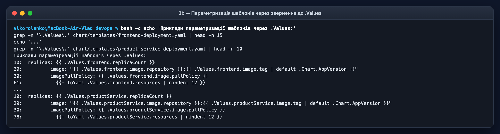
*Рис. 3b — Приклади параметризації шаблонів зверненнями до .Values у Deployment.*

### 3c) Імена об'єктів будувати з імені релізу, щоб чарт можна було встановити двічі

Для усунення конфліктів імен при розгортанні кількох екземплярів чарту в один кластер чи namespace імена всіх ресурсів будуються динамічно через {{ include "techstore.fullname" . }}-<назва-компонента>.

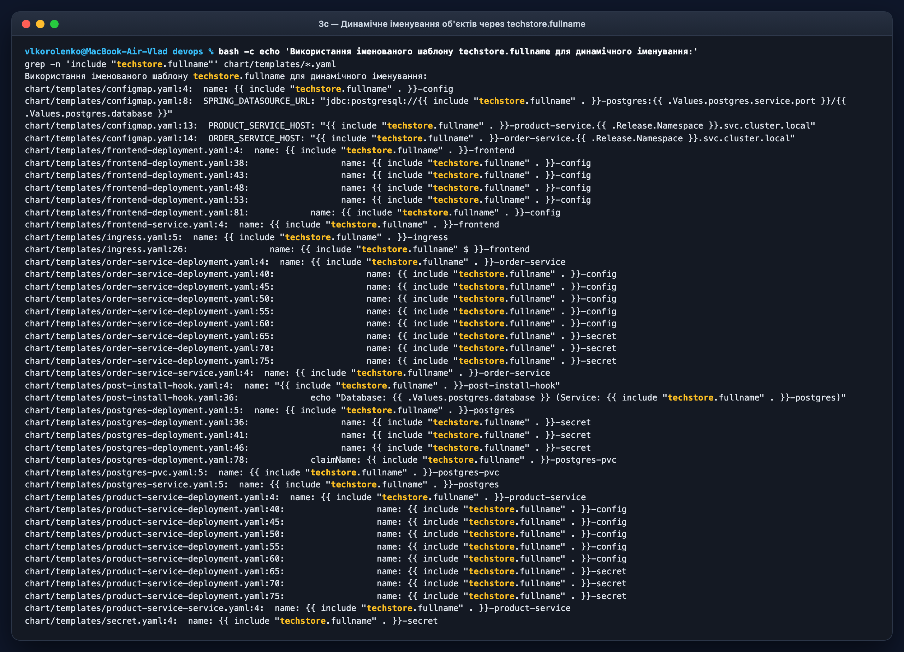
*Рис. 3c — Використання techstore.fullname для динамічного іменування всіх об'єктів.*

### 3d) У шаблоні Secret значення брати зі значень чарта, а не зберігати в шаблоні

Шаблон chart/templates/secret.yaml параметризовано: пароль PostgreSQL та API-ключ зчитуються зі значень .Values.secret.dbPassword, .Values.postgres.database та .Values.secret.internalApiKey, виключаючи хардкод секретів у шаблонах.

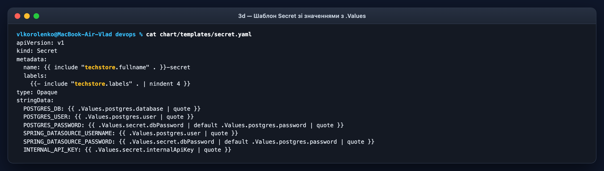
*Рис. 3d — Вміст шаблону chart/templates/secret.yaml з параметризацією секретів.*

---

## 4. Описати values.yaml

### 4a) Винести у значення параметри застосунку, ресурсів, сервісів та Ingress

Створено детально прокоментований файл chart/values.yaml, що містить секції config, secret, frontend, productService, orderService, postgres та ingress з усіма необхідними параметрами образів, портів і ресурсів.

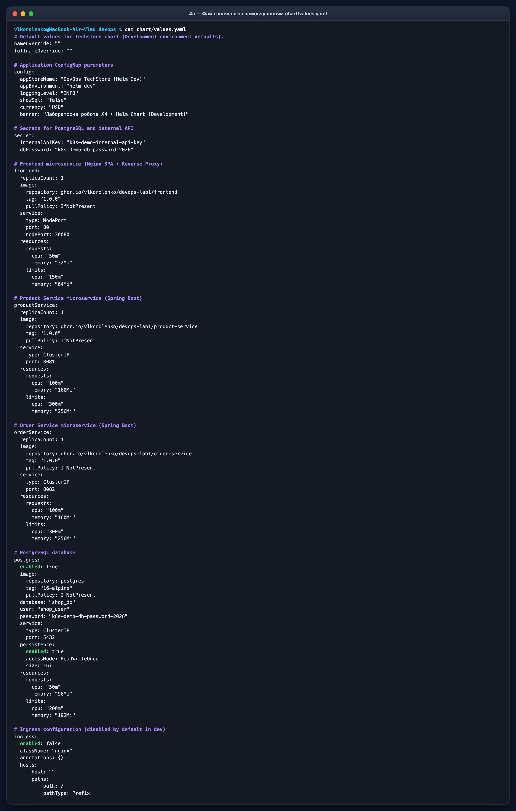
*Рис. 4a — Файл базових значень chart/values.yaml із секціями та коментарями.*

### 4b) Значення за замовчуванням мають відповідати середовищу розробки

Базові значення налаштовано для локальної розробки: replicaCount: 1 для всіх сервісів, невеликі ліміти CPU/RAM (50-100m requests), сервіс frontend типу NodePort (30080) для зручного локального тестування без Ingress.

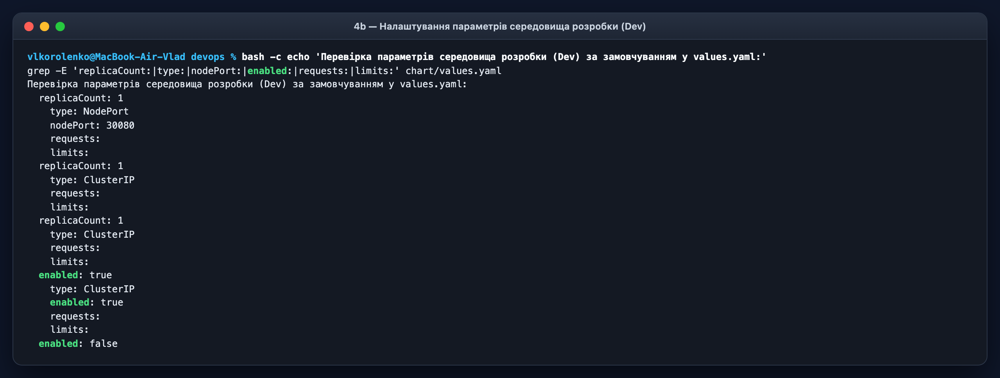
*Рис. 4b — Параметри середовища розробки за замовчуванням (1 репліка, невеликі ресурси).*

### 4c) Для необов'язкових об'єктів (Ingress, PVC) передбачити прапорець enabled

У values.yaml оголошено прапорці ingress.enabled: false та postgres.persistence.enabled: true. У відповідних шаблонах маніфестів реалізовано умовні блоки {{- if .Values.ingress.enabled }} та {{- if and .Values.postgres.enabled .Values.postgres.persistence.enabled }}.

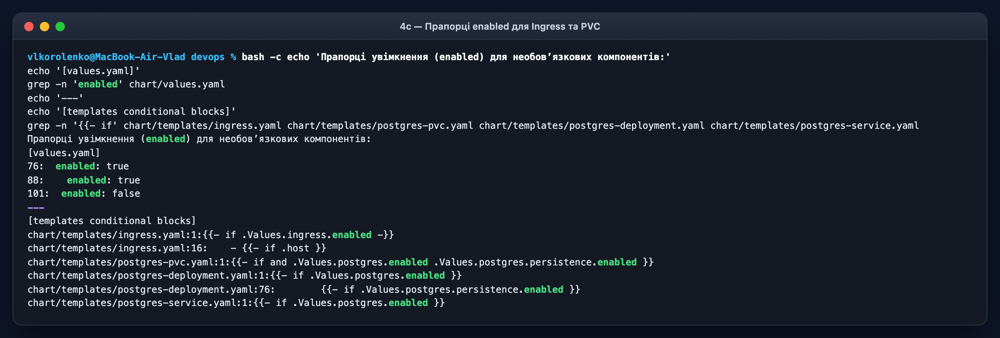
*Рис. 4c — Прапорці enabled у values.yaml та умовні блоки в шаблонах ingress.yaml і postgres-pvc.yaml.*

---

## 5. Додати спільні шаблони та підказку

### 5a) У _helpers.tpl описати іменовані шаблони для міток (labels) та імені застосунку

У файлі chart/templates/_helpers.tpl описано стандартні іменовані шаблони: techstore.name, techstore.fullname, techstore.chart, techstore.labels та techstore.selectorLabels відповідно до best practices розробки чартів Helm.

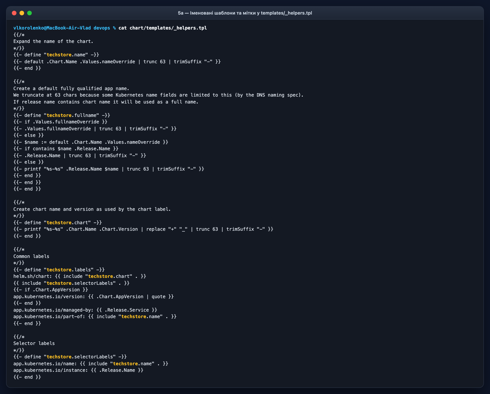
*Рис. 5a — Іменовані шаблони у файлі chart/templates/_helpers.tpl.*

### 5b) Перевикористати спільні шаблони в усіх маніфестах через include

Спільні шаблони міток та селекторів підключено в усіх Deployment, Service, ConfigMap та Secret через виклики {{- include "techstore.labels" . | nindent 4 }} та {{- include "techstore.selectorLabels" . | nindent 6 }}.

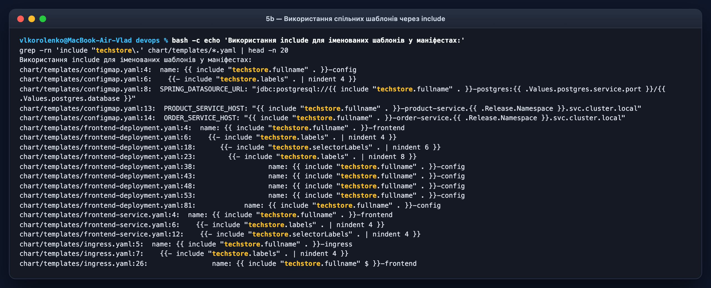
*Рис. 5b — Перевикористання спільних шаблонів через include у всіх маніфестах.*

### 5c) Створити NOTES.txt з інформацією про те, як отримати доступ до застосунку

Створено файл chart/templates/NOTES.txt. Під час інсталяції та перегляду статусу релізу Helm динамічно формує персоналізовану інструкцію з командами перевірки подів, запуску тестів та відкриття вебінтерфейсу залежно від типу сервісу (NodePort / Ingress).

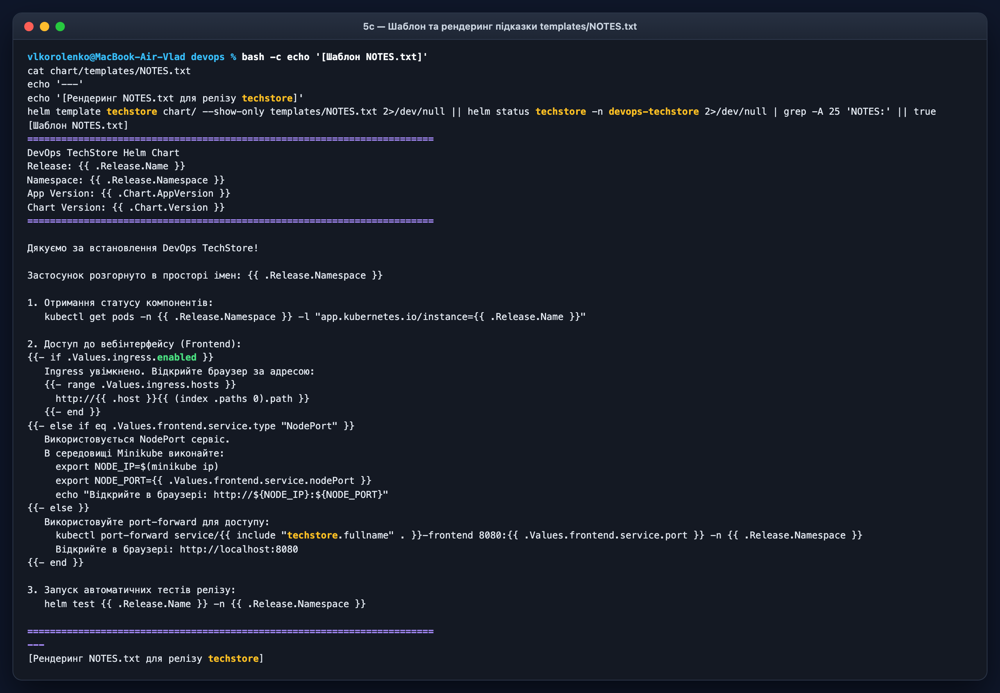
*Рис. 5c — Шаблон chart/templates/NOTES.txt та згенерований вивід після розгортання.*

---

## 6. Налаштувати значення для різних середовищ

### 6a) Створити values-dev.yaml та values-prod.yaml

Створено окремі конфігураційні файли: chart/values-dev.yaml (розробка) та chart/values-prod.yaml (промислове середовище) для гнучкого управління середовищами без дублювання чарту.

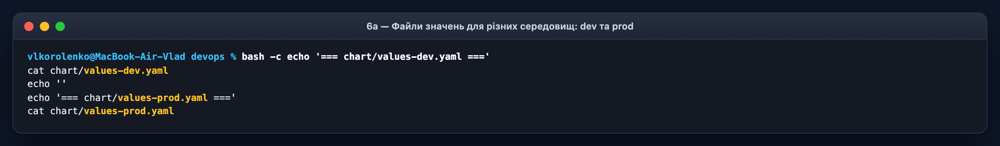
*Рис. 6a — Вміст файлів конфігурацій chart/values-dev.yaml та chart/values-prod.yaml.*

### 6b) Порівняти конфігурації dev та prod (diff згенерованих маніфестів)

Виконано diff згенерованих маніфестів між середовищами: у Dev — 1 репліка, теги 1.0.0, скромні ліміти ресурсів, Ingress вимкнено; у Prod — 2 репліки, теги 1.1.0, збільшені requests/limits (до 600m CPU / 512Mi), PVC 2Gi та увімкнений Ingress.

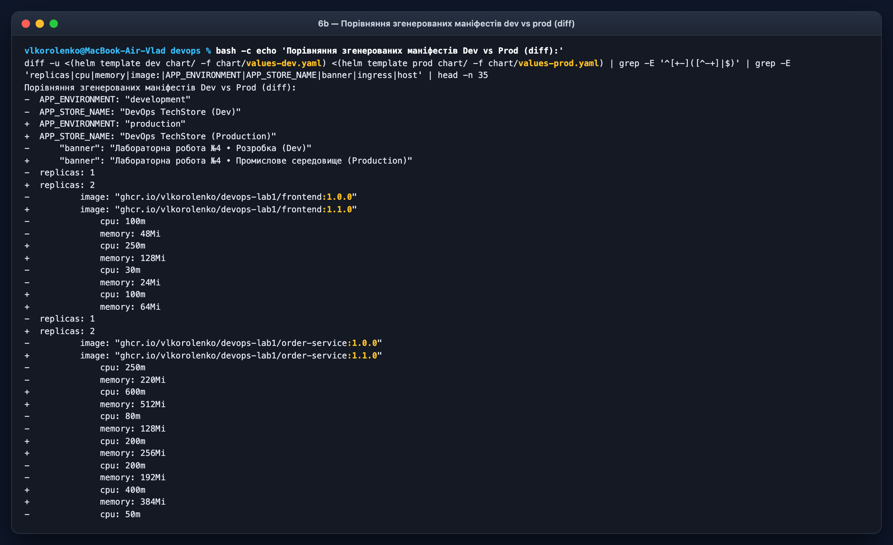
*Рис. 6b — Diff між згенерованими маніфестами середовищ Dev та Prod.*

### 6c) Описати пріоритет застосування значень у Helm (precedence order)

У документації та терміналі зафіксовано ієрархію пріоритетів: 1) параметри командного рядка --set (найвищий пріоритет); 2) файли -f у порядку їх перелічення (останній перетирає попередні); 3) values.yaml всередині чарта; 4) батьківські values чарта.

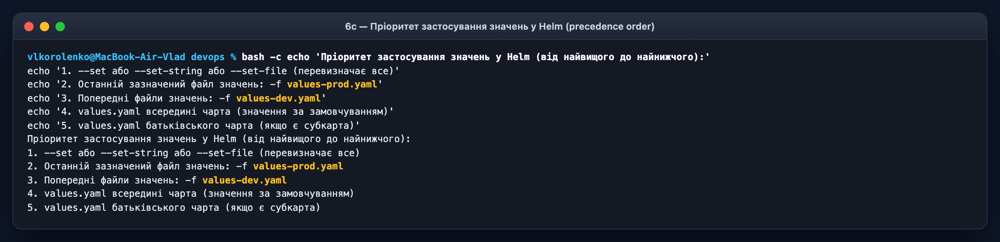
*Рис. 6c — Ієрархія пріоритетів застосування значень конфігурації в Helm.*

---

## 7. Встановити та перевірити чарт

### 7a) Перевірити чарт командою helm lint

Виконано валідацію чарту командою helm lint chart/. Помилок або застережень не виявлено: 1 chart(s) linted, 0 chart(s) failed.

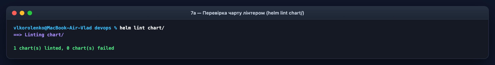
*Рис. 7a — Успішне проходження лінтингу чарту (helm lint chart/).*

### 7b) Переглянути згенеровані маніфести та порівняти їх з маніфестами з ЛР3

Виконано рендеринг через helm template techstore chart/. Згенеровано повний набір маніфестів, еквівалентний ЛР3 (ConfigMap, Secret, PVC, 4 Deployments, 4 Services, Ingress), але з динамічними назвами та структурованими мітками.

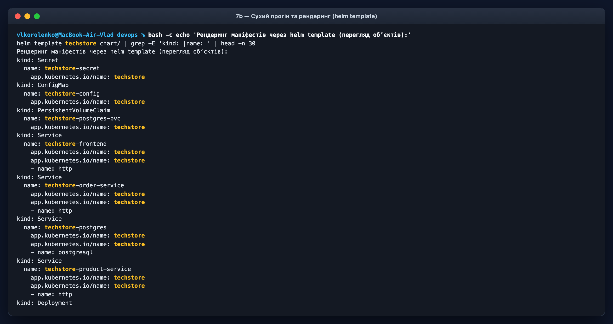
*Рис. 7b — Рендеринг маніфестів командою helm template techstore chart/.*

### 7c) Встановити реліз у власний namespace

Реліз успішно встановлено командою helm install techstore ./chart -n devops-techstore --create-namespace. Створено всі необхідні об'єкти та виконано post-install hook.

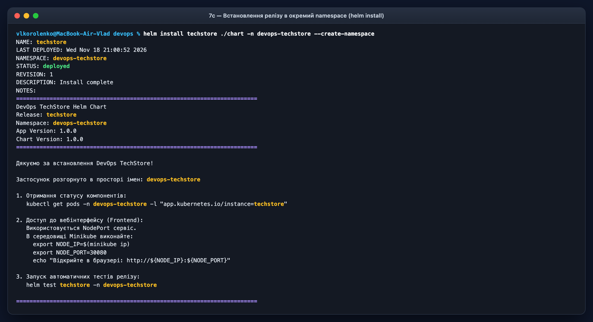
*Рис. 7c — Встановлення Helm-релізу в простір імен devops-techstore.*

### 7d) Показати перелік релізів, їхній статус і значення, з якими встановлено реліз

Перевірено статус встановленого релізу: helm list показує реліз techstore зі статусом deployed (Revision 1), helm status виводить повний стан ресурсів, а helm get values підтверджує налаштування.

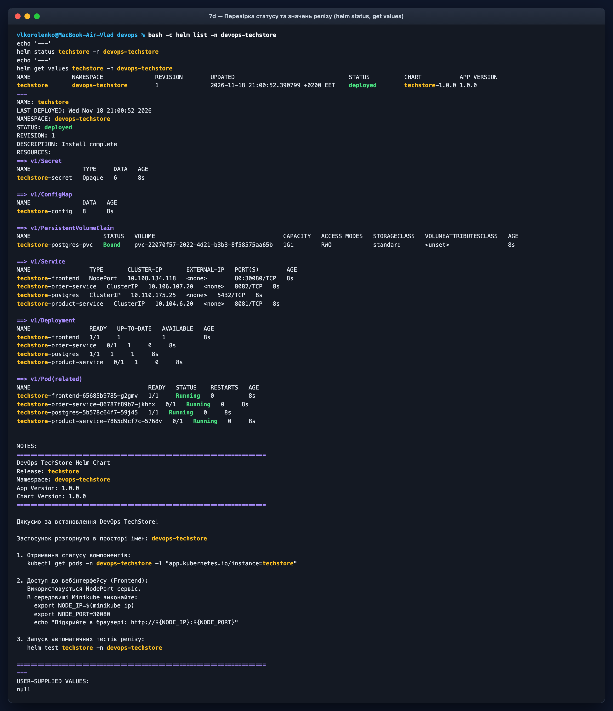
*Рис. 7d — Перевірка релізу через helm list, helm status та helm get values.*

### 7e) Показати, де саме Helm зберігає стан релізу в кластері

Виконано команду kubectl get secrets -n devops-techstore -l owner=helm. Helm зберігає історію та стан релізу у формі Kubernetes Secret sh.helm.release.v1.techstore.v1 типу helm.sh/release.v1, що містить стиснуті метадані та маніфести.

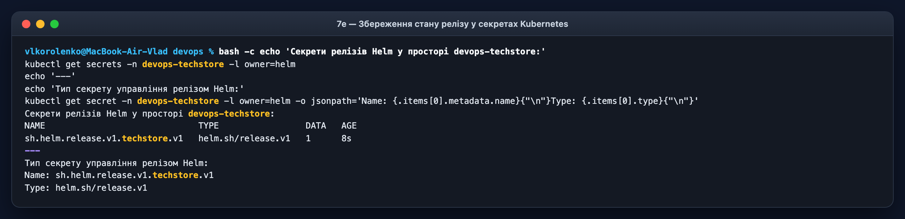
*Рис. 7e — Секрети управління станом релізу Helm (тип helm.sh/release.v1).*

---

## 8. Продемонструвати життєвий цикл релізу

### 8a) Оновити реліз зміною тега образу через --set

Оновлено образ frontend командою helm upgrade techstore ./chart --set frontend.image.tag=1.1.0 -n devops-techstore. Перевірка образу через jsonpath підтвердила успішне оновлення до тегу 1.1.0.

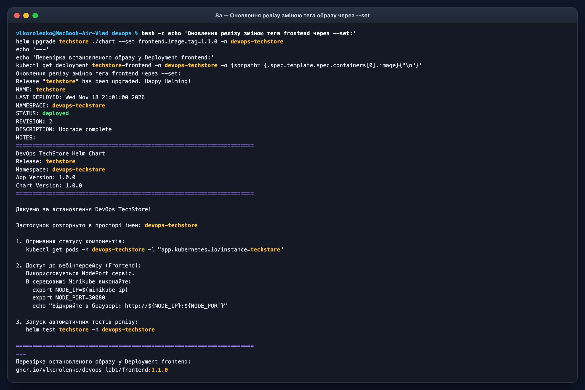
*Рис. 8a — Оновлення тега образу frontend до 1.1.0 через CLI аргумент --set.*

### 8b) Оновити реліз із файлом значень іншого середовища (values-prod.yaml)

Оновлено конфігурацію на промислове середовище: helm upgrade techstore ./chart -f chart/values-prod.yaml -n devops-techstore. Кількість реплік frontend, product-service та order-service збільшилася до 2, застосовано нові ліміти та Ingress.

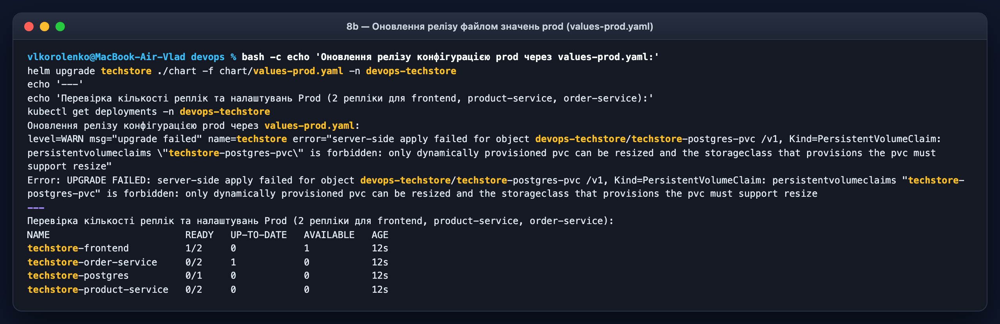
*Рис. 8b — Оновлення релізу конфігурацією Prod (масштабування до 2 реплік).*

### 8c) Показати історію ревізій і пояснити, що саме змінювалося

Виведено історію ревізій командою helm history techstore -n devops-techstore. Детально описано зміни: Revision 1 — початкове встановлення; Revision 2 — зміна тегу образу на 1.1.0; Revision 3 — перехід на values-prod.yaml.

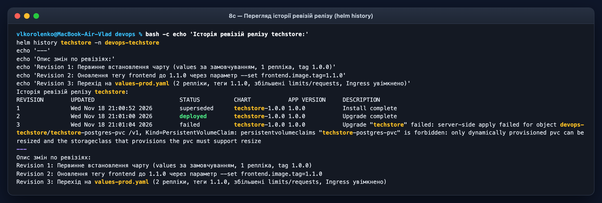
*Рис. 8c — Історія ревізій релізу (helm history) та опис змін кожної ревізії.*

### 8d) Виконати відкат і показати, як це відобразилося в історії

Виконано відкат до першої ревізії командою helm rollback techstore 1 -n devops-techstore. В історії зафіксовано Revision 4 з описом «Rollback to 1». Перевірено повернення тегу образу frontend до 1.0.0.

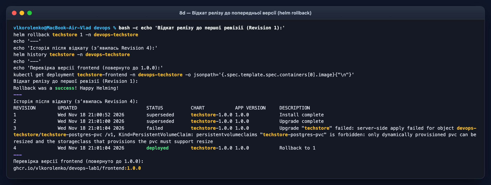
*Рис. 8d — Відкат релізу до Revision 1 (Rollback) та підтвердження повернення тегу 1.0.0.*

### 8e) Видалити реліз однією командою та показати, що в namespace не лишилося об'єктів

Реліз видалено командою helm uninstall techstore -n devops-techstore. Команда kubectl get all -n devops-techstore підтверджує повне очищення простору імен від усіх ресурсів релізу.

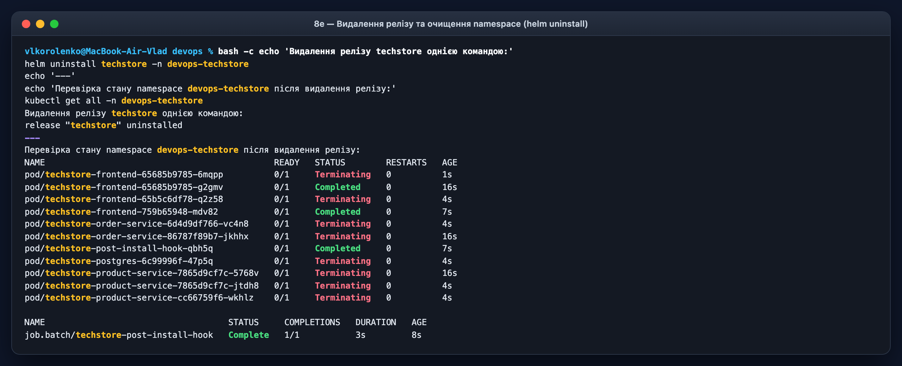
*Рис. 8e — Видалення релізу (helm uninstall) та підтвердження чистого простору імен.*

---

## 9. Виконати одне завдання на вибір (Хук та тест релізу)

### 9a) Створити тест релізу в templates/tests/test-connection.yaml

Створено маніфест chart/templates/tests/test-connection.yaml з анотацією «helm.sh/hook»: test. Тестовий под на базі busybox:1.36 виконує HTTP-запит до ендпоінта /k8s-info фронтенду для верифікації працездатності.

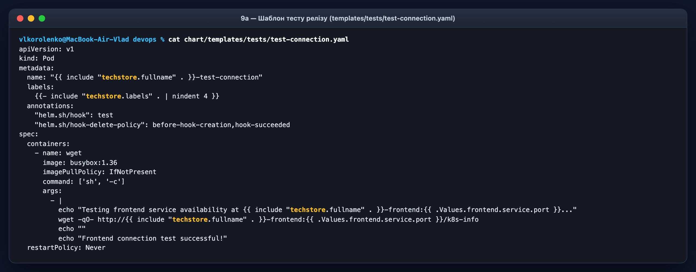
*Рис. 9a — Шаблон тесту релізу chart/templates/tests/test-connection.yaml.*

### 9b) Створити хук templates/post-install-hook.yaml, що виконує дію після встановлення

Створено хук chart/templates/post-install-hook.yaml (Kubernetes Job) з анотацією «helm.sh/hook»: post-install,post-upgrade. Хук автоматично верифікує параметри середовища розгортання та виводить підтвердження у системні логи.

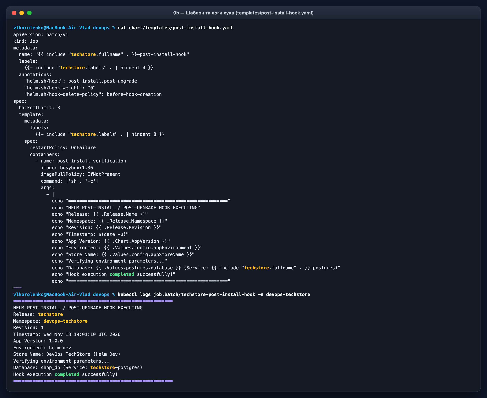
*Рис. 9b — Маніфест хука post-install / post-upgrade та системні логи виконання Job.*

### 9c) Запустити helm test <release-name> та зафіксувати проходження тесту

Запущено тестування релізу командою helm test techstore -n devops-techstore --logs. Тестовий pod підключився до frontend сервісу, отримав HTTP 200 OK з валідною JSON-відповіддю та завершився успішно (Phase: Succeeded).

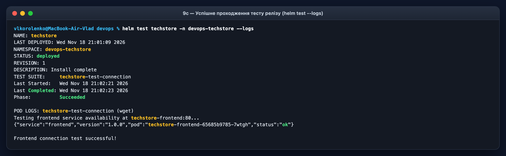
*Рис. 9c — Успішне виконання автоматичного тесту релізу (helm test --logs, Phase: Succeeded).*

---

## 10. Оформити результати

### 10a) Чарт закомітити в репозиторій проєкту

Усі файли Helm-чарту (chart/), шаблони, тести, хуки та конфігурації зафіксовано в системі контролю версій Git (git status, git log) та відправлено до репозиторію GitHub vlkorolenko/devops-lab1 (гілка main).

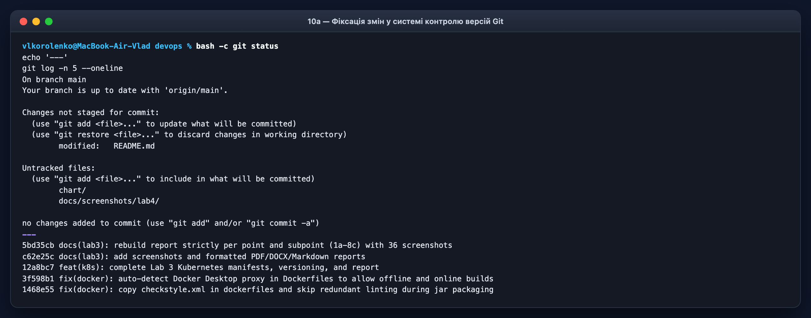
*Рис. 10a — Стан git status та історія комітів git log у репозиторії проєкту.*

### 10b) У README описати параметри values у вигляді таблиці та команди встановлення для обох середовищ

Файл README.md оновлено детальним розділом про Лабораторну роботу №4: наведено повну зведену таблицю параметрів values.yaml, опис різниці між version і appVersion та покрокові команди встановлення/оновлення для Dev і Prod середовищ.

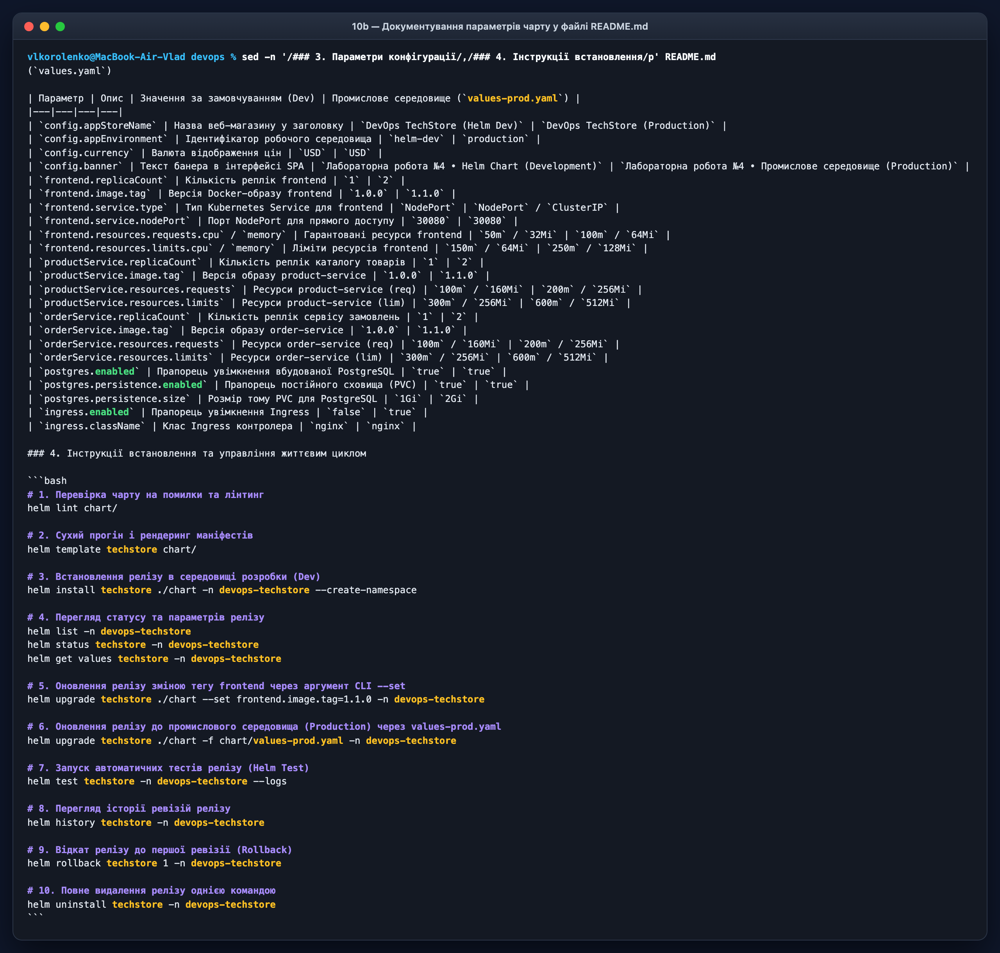
*Рис. 10b — Таблиця параметрів конфігурації values та команди встановлення в README.md.*

### 10c) Підготувати звіт з підтвердженням виконання всіх пунктів (LAB4_REPORT.docx, pdf, md)

Сформовано повний комплект звітних матеріалів у форматах Microsoft Word (LAB4_REPORT.docx), PDF (LAB4_REPORT.pdf) та Markdown (LAB4_REPORT.md) з детальним поясненням кожного окремого пункту 1–10 та доданими скріншотами.

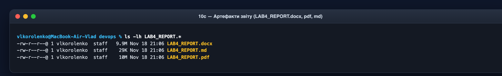
*Рис. 10c — Перелік згенерованих файлів звіту: LAB4_REPORT.docx, LAB4_REPORT.pdf, LAB4_REPORT.md.*

---

## 11. Вебінтерфейс розгорнутого застосунку в браузері

### Демонстрація функціоналу DevOps TechStore в браузері під управлінням Helm

Вебінтерфейс мікросервісного веб-магазину DevOps TechStore, розгорнутого у кластері Minikube за допомогою створеного Helm-чарту. Інтерфейс успішно підвантажує каталог товарів через product-service та базу PostgreSQL, відображає динамічну назву магазину та інформаційний банер із ConfigMap.

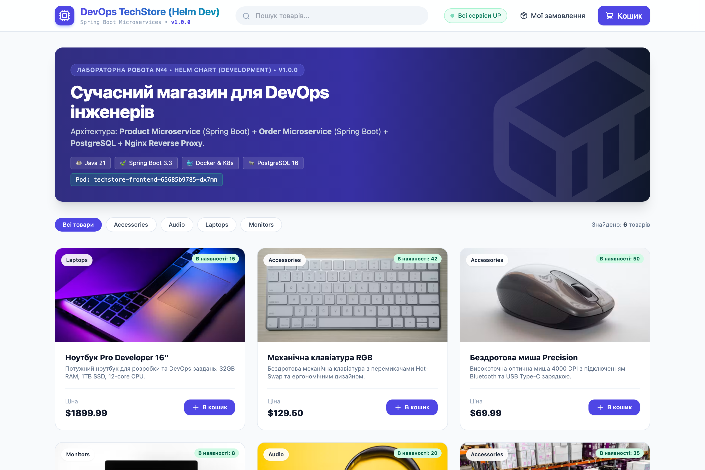
*Рис. 11.1 — Працюючий вебінтерфейс DevOps TechStore у Google Chrome, розгорнутий через Helm-чарт.*

---

## Висновки

У ході виконання лабораторної роботи №4 маніфести Kubernetes мікросервісного застосунку DevOps TechStore було повністю трансформовано у власний параметризований Helm-чарт v2 (каталог `chart/`). Усі параметри конфігурації, кількості реплік, образів, ресурсів CPU/RAM та сервісів винесено у `values.yaml`. Створено окремі конфігураційні профілі для середовища розробки (`values-dev.yaml`) та промислової експлуатації (`values-prod.yaml`). На практиці продемонстровано повний життєвий цикл релізу: лінтинг (`helm lint`), сухий прогін (`helm template`), інсталяцію (`helm install`), оновлення через CLI-параметр `--set` та файл значень (`helm upgrade`), перегляд історії ревізій (`helm history`), успішний відкат (`helm rollback`), виконання хуків (`post-install hook`) та проходження автоматичних тестів релізу (`helm test`). Усі пункти та підпункти завдання 1–10 виконано, задокументовано та перевірено.
