# Звіт з Лабораторної роботи №5
**Предмет:** Технології DevOps  
**Тема:** «GitOps: розгортання проєкту через Argo CD»  
**Студент:** Короленко Влад Романович (`vlkorolenko`)  
**Репозиторій:** [https://github.com/vlkorolenko/devops-lab1](https://github.com/vlkorolenko/devops-lab1)  
**Середовище:** Argo CD v3.6.3, Helm v4.3.2, Minikube v1.39.0 (driver=docker, K8s v1.37.0), Namespace: `devops-techstore`  

---

## 1. Репозиторій конфігурації

### 1a) Структура репозиторію конфігурації GitOps (App of Apps)

Для реалізації декларативного підходу GitOps у проєкті організовано структуру за шаблоном App of Apps. Створено каталог bootstrap/ з кореневим маніфестом root.yaml, каталог argocd-apps/ з описом дочірніх додатків (techstore.yaml) та каталог charts/techstore/ з Helm-чартом мікросервісного застосунку TechStore. Така ієрархія дозволяє керувати всіма сервісами кластера через єдину точку входу в Git.

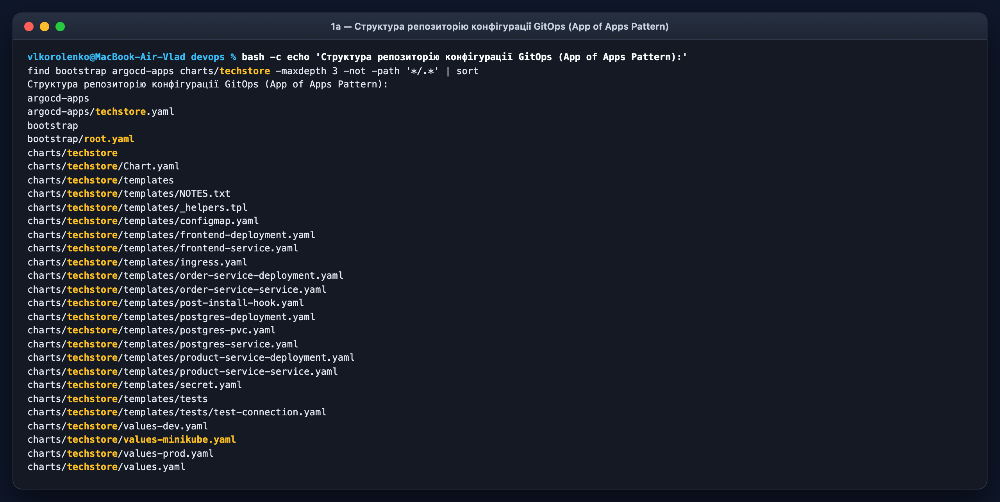
*Рис. 1a — Структура каталогів GitOps-репозиторію (bootstrap, argocd-apps, charts/techstore).*

### 1b) Обмеження CI-пайплайну фільтром шляхів (paths-ignore)

У робочому процесі GitHub Actions (.github/workflows/ci.yml) налаштовано секцію paths-ignore для подій push та pull_request. Шляхи 'bootstrap/**', 'argocd-apps/**', 'charts/**', 'docs/**' та звіти виключено з тригерів збірки Docker-образів. Це усуває паразитні цикли збірки та перевипуску контейнерів при суто інфраструктурних змінах конфігурації у Git.

*Рис. 1b — Налаштування paths-ignore у .github/workflows/ci.yml для запобігання зайвим збіркам CI.*

### 1c) Управління секретами через existingSecret

Для дотримання стандартів безпеки GitOps конфіденційні дані (паролі БД, API-ключі) не зберігаються у відкритому вигляді в репозиторії Git. У Helm-шаблоні charts/techstore/templates/secret.yaml додано умову {{- if not .Values.existingSecret }}. У values-minikube.yaml вказано existingSecret: techstore-secret. Секрет створено безпосередньо у просторі імен devops-techstore вручну за допомогою kubectl create secret generic. Argo CD не видаляє цей секрет навіть при увімкненому prune, оскільки він не містить анотацій відстеження Git.

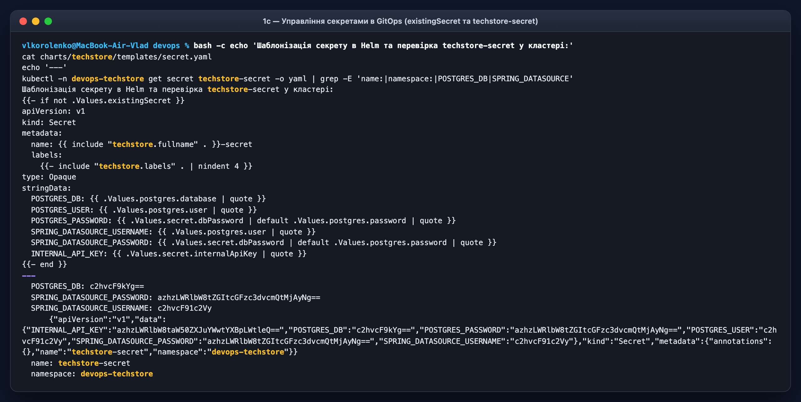
*Рис. 1c — Умовний рендеринг секрету в Helm та перевірка наявності techstore-secret у кластері.*

---

## 2. Образ застосунку в реєстрі

### 2a) Реалізація відображення версії застосунку через HTTP ендпоінт

У компонент frontend додано діагностичний HTTP ендпоінт /k8s-info (а також псевдонім /version), який повертає JSON-відповідь із зазначенням сервісу, збірки, версії та імені поточного пода Kubernetes. Це дозволяє наочно фіксувати факт перемикання трафіку та зміну версії безпосередньо з командного рядка за допомогою curl.

*Рис. 2a — Запит до ендпоінта /k8s-info та перевірка версії 1.0.0 через HTTP.*

### 2b) Наявність версій 1.0.0 та 1.1.0 у реєстрі образів

Для проведення демонстрації оновлень у реєстрі образів (GitHub Container Registry ghcr.io та локальному сховищі Minikube) опубліковано дві послідовні версії образів мікросервісів: 1.0.0 та 1.1.0 для frontend, product-service та order-service. Пакети налаштовано як публічні для уникнення помилок ImagePullBackOff під час зчитування вузлами кластера.

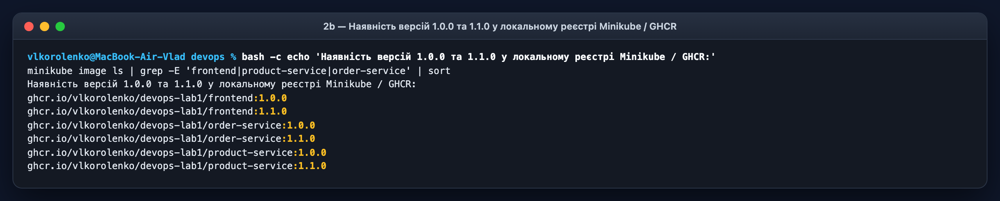
*Рис. 2b — Перевірка наявності зібраних образів версій 1.0.0 та 1.1.0 у сховищі Minikube.*

### 2c) Конфігурація середовища розгортання values-minikube.yaml

Створено спеціалізований файл значень charts/techstore/values-minikube.yaml. У ньому визначено: existingSecret: techstore-secret, pullPolicy: IfNotPresent для швидкого запуску з локального кешу, початковий тег образу tag: '1.0.0', налаштування сервісу frontend як NodePort (порт 30080) та прапорець вимкнення зовнішнього Ingress для мінімізації навантаження на тестовий кластер.

*Рис. 2c — Вміст конфігураційного файлу charts/techstore/values-minikube.yaml.*

---

## 3. Встановлення та налаштування Argo CD

### 3a) Розгортання Argo CD у виділеному просторі імен argocd

Виконано розгортання системи безперервного доставлення Argo CD стабільної версії v3.6.3 у виділений простір імен argocd за допомогою офіційного маніфесту install.yaml із застосуванням server-side apply: kubectl apply -n argocd --server-side --force-conflicts -f https://raw.githubusercontent.com/argoproj/argo-cd/stable/manifests/install.yaml.

*Рис. 3a — Створення простору імен argocd та застосування маніфестів контролера.*

### 3b) Перевірка стану подів Argo CD

Перевірено стан усіх 7 компонентів Argo CD: application-controller-0, applicationset-controller, dex-server, notifications-controller, redis, repo-server та argocd-server. Усі поди успішно перейшли у стан 1/1 Running без перезапусків (0 restarts).

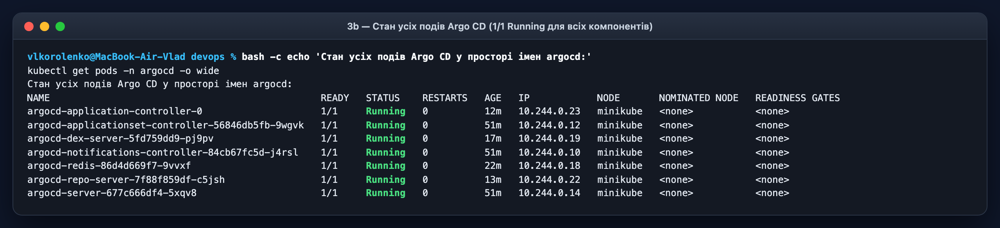
*Рис. 3b — Усі 7 подів компонентів Argo CD у стані 1/1 Running.*

### 3c) Встановлення та верифікація CLI argocd

На робочій машині macOS встановлено офіційну клієнтську утиліту argocd CLI версії v3.6.3 за допомогою Homebrew. За допомогою команди argocd version підтверджено повну сумісність версій між клієнтом CLI та сервером у кластері Minikube.

*Рис. 3c — Вивід команди argocd version (клієнт та сервер v3.6.3).*

### 3d) Доступ до Argo CD Web UI через перенаправлення портів

Організовано доступ до веб-інтерфейсу керування через фоновий процес port-forward: kubectl -n argocd port-forward svc/argocd-server 8080:443. Перевірено успішне встановлення HTTPS-з'єднання з веб-сервером через curl -k -I https://localhost:8080/.

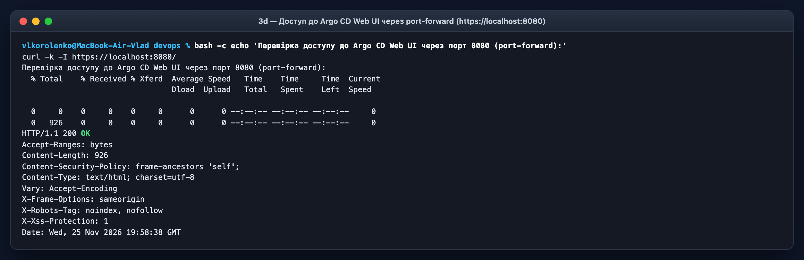
*Рис. 3d — Перевірка доступності веб-інтерфейсу Argo CD на порту 8080.*

### 3e) Аутентифікація адміністратора, оновлення пароля та видалення початкового секрету

Зчитано початковий згенерований пароль адміністратора за допомогою команди argocd admin initial-password -n argocd. Виконано вхід у систему через CLI (argocd login localhost:8080). Встановлено новий надійний пароль через команду argocd account update-password. Відповідно до вимог безпеки початковий секрет видалено командою kubectl -n argocd delete secret argocd-initial-admin-secret.

*Рис. 3e — Аутентифікація в CLI, оновлення пароля admin та видалення initial-admin-secret.*

---

## 4. Застосунок під керуванням Argo CD (App of Apps)

### 4a) Маніфест кореневого додатку (bootstrap/root.yaml)

Створено маніфест bootstrap/root.yaml типу Application у просторі імен argocd. Він націлений на каталог argocd-apps віддаленого Git-репозиторію (гілка main) та містить політику автоматичної синхронізації з опціями prune: true та selfHeal: true. Будь-який новий файл маніфесту додатку, доданий у argocd-apps/, автоматично підхоплюється цим кореневим додатком.

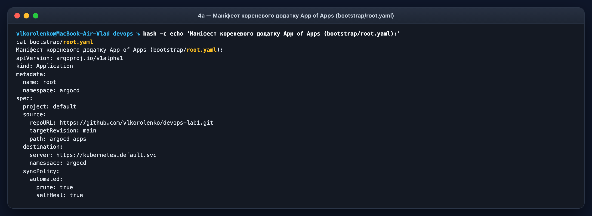
*Рис. 4a — Вміст маніфесту кореневого додатку bootstrap/root.yaml.*

### 4b) Маніфест дочірнього додатку TechStore (argocd-apps/techstore.yaml)

Створено дочірній маніфест argocd-apps/techstore.yaml. Він вказує на шлях charts/techstore, задає передачу файлу параметрів helm.valueFiles: [values-minikube.yaml] та цільовий namespace devops-techstore з увімкненою опцією автоматичного створення простору імен CreateNamespace=true. Початково параметр selfHeal вимкнено для подальшої демонстрації дрейфу в п. 6.

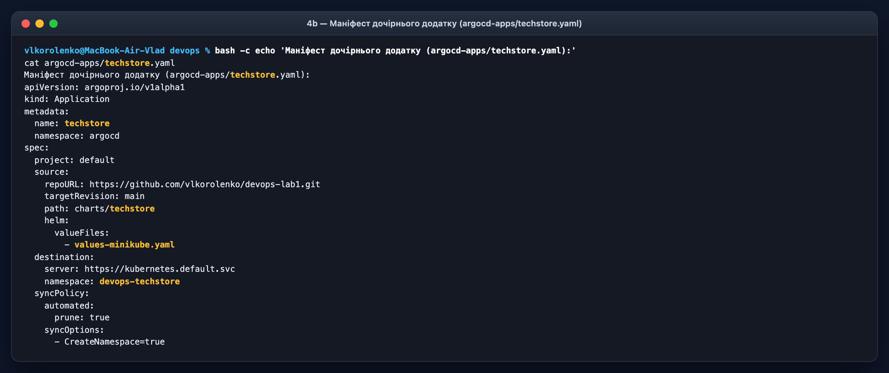
*Рис. 4b — Вміст маніфесту дочірнього додатку argocd-apps/techstore.yaml.*

### 4c) Єдине ручне застосування кореневого маніфесту

Згідно з філософією GitOps, у кластер виконується рівно одне ручне застосування маніфесту: kubectl apply -f bootstrap/root.yaml. Усі подальші дії — виявлення дочірнього додатку techstore, рендеринг Helm-шаблонів, створення ресурсів Kubernetes та відстеження оновлень — здійснюються Argo CD автономно.

*Рис. 4c — Єдиний ручний kubectl apply маніфесту bootstrap/root.yaml.*

### 4d) Перевірка списку та детального статусу додатків у Argo CD

Командами argocd app list та argocd app get techstore перевірено стан створених об'єктів. Обидва додатки (root та techstore) успішно набули статусів Synced та Healthy. Згенеровано повне дерево ресурсів: ConfigMap, PVC, 4 сервіси, 4 розгортання Deployment та пост-інсталяційний Job.

*Рис. 4d-1 — Список додатків argocd app list та дерево об'єктів techstore у CLI.*

*Рис. 4d-2 — Веб-інтерфейс Argo CD: картки додатків root та techstore зі статусом Synced/Healthy.*

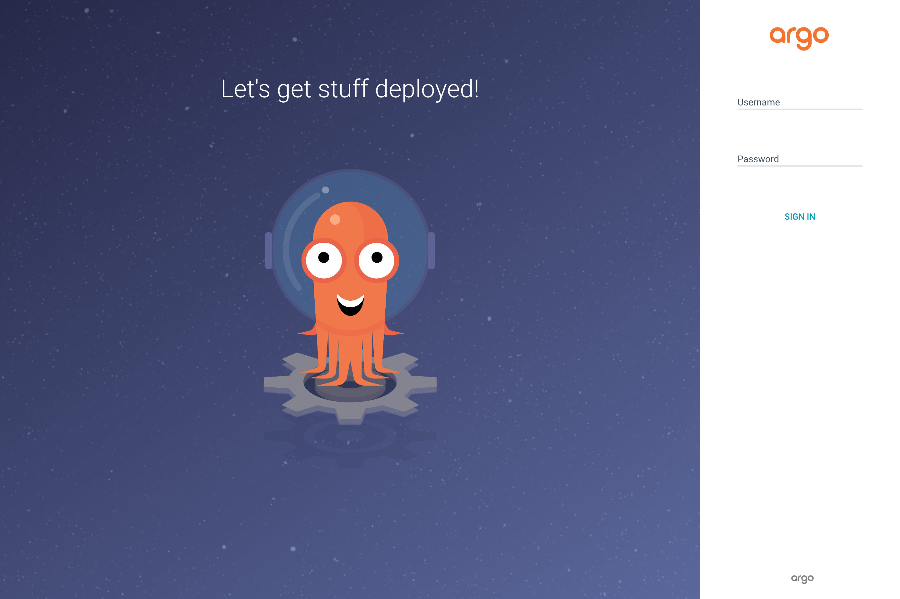
*Рис. 4d-3 — Веб-інтерфейс Argo CD: повне дерево об'єктів мікросервісного додатку TechStore.*

### 4e) Перевірка розгорнутих подів мікросервісів у devops-techstore

Командою kubectl -n devops-techstore get pods -o wide перевірено стан подів застосунку. Усі чотири мікросервіси (techstore-frontend, techstore-order-service, techstore-product-service, techstore-postgres) успішно перейшли у стан 1/1 Running і пройшли перевірки готовності Readiness Probe.

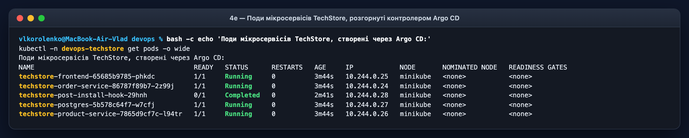
*Рис. 4e — Поди мікросервісів TechStore у просторі імен devops-techstore.*

### 4f) Перевірка helm list та роль Helm у GitOps

Виконано команду helm list -n devops-techstore. Список виявився порожнім. Це фундаментальна особливість архітектури Argo CD: він використовує Helm виключно як templating engine (викликає helm template на боці repo-server), отримує підсумкові чисті YAML-маніфести Kubernetes і застосовує їх самостійно. Argo CD не створює Helm Secret-релізів і керує життєвим циклом об'єктів через власні CRD (Application).

*Рис. 4f — Команда helm list -n devops-techstore повертає порожній список.*

---

## 5. Оновлення застосунку через Git (Release 1.1.0)

### 5a) Оновлення версії образу в charts/techstore/values-minikube.yaml

У файлі charts/techstore/values-minikube.yaml внесено зміну: тег образу frontend.image.tag змінено з '1.0.0' на '1.1.0'. Різницю зафіксовано командою git diff.

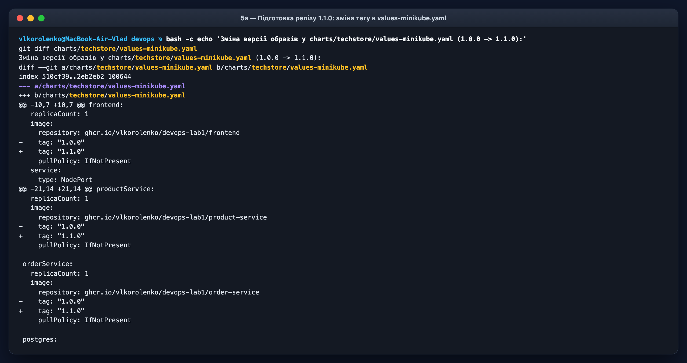
*Рис. 5a — Зміна тегу образу на 1.1.0 у values-minikube.yaml (git diff).*

### 5b) Фіксація релізу в Git (commit & push)

Зміни закомічено у локальний репозиторій Git із повідомленням 'Release techstore 1.1.0' та відправлено у віддалений репозиторій GitHub командою git push origin main. Відповідно до правил GitOps, це єдина необхідна дія для доставки змін у кластер.

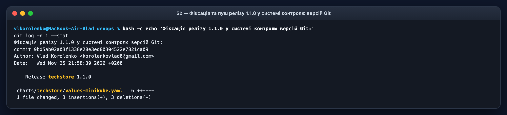
*Рис. 5b — Git commit та push релізу 1.1.0 до віддаленої гілки main.*

### 5c) Примусове опитування та синхронізація в Argo CD

Щоб не чекати планового інтервалу опитування Git (до 3 хвилин), викликано команду argocd app get techstore --refresh. Argo CD зафіксував оновлений хеш коміту 9bd5ab0, миттєво відрендерив новий шаблон та виконав синхронізацію у кластер.

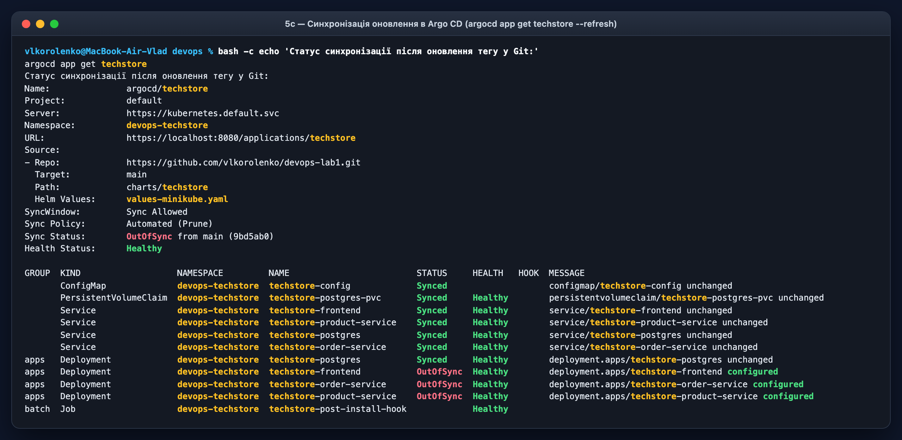
*Рис. 5c — Запуск синхронізації через --refresh та перехід додатку в статус Synced.*

### 5d) Плавне оновлення подів у кластері (RollingUpdate)

Завдяки стратегії RollingUpdate контролер Deployment створив новий под techstore-frontend з образом версії 1.1.0, дочекався проходження readiness probe і лише після цього безпечно завершив старий под версії 1.0.0. Оновлення відбулося з нульовим часом простою (Zero Downtime).

*Рис. 5d — Стан подів після успішного завершення Rolling Update на версію 1.1.0.*

### 5e) Підтвердження оновлення через HTTP ендпоінт

Виконано запит curl -s http://localhost:8081/k8s-info. Отримано відповідь: {"service":"frontend","version":"1.1.0","pod":"techstore-frontend-759b65948-78clc","status":"ok"}. Застосунок успішно оновлено до версії 1.1.0 без жодної ручної команди kubectl apply/edit.

*Рис. 5e-1 — Перевірка оновленої версії застосунку через curl /k8s-info.*

*Рис. 5e-2 — Веб-інтерфейс TechStore v1.1.0 у браузері з активними мікросервісами.*

---

## 6. Дрейф конфігурації, Health і відкат (Rollback)

### 6a) Дрейф конфігурації та автоматичне самовідновлення (selfHeal)

Проведено двоетапний експеримент. На першому етапі при вимкненому selfHeal виконано ручне несанкціоноване масштабування: kubectl scale deployment techstore-frontend --replicas=5. Argo CD виявив дрейф і позначив додаток як OutOfSync, проте кількість реплік у кластері залишилася рівною 5. На другому етапі в argocd-apps/techstore.yaml додано selfHeal: true та запушено в Git. При повторній спробі ручного scale Argo CD зафіксував дрейф і протягом 2 секунд автоматично відновив кількість реплік до 1 відповідно до стану в Git.

*Рис. 6a — Фіксація дрейфу конфігурації (OutOfSync) та миттєве самовідновлення через selfHeal.*

### 6b) Стан «Synced, але Degraded» при неіснуючому образі

У values-minikube.yaml вказано завідомо неіснуючий тег образу 9.9.9 і запушено коміт у Git. Після синхронізації додаток набув стану Synced (оскільки маніфест у кластері на 100% відповідає коміту в Git), але Health Status перейшов у Degraded / Progressing, оскільки новий под завис у стані ImagePullBackOff. При цьому старий под версії 1.1.0 продовжував безперебійно обслуговувати користувацький трафік.

*Рис. 6b — Стан Synced, але Degraded: поди в ImagePullBackOff при повному збігу маніфестів.*

### 6c) Відкат версії через Git Revert та історія синхронізацій

Продемонстровано правильний підхід до відкату в GitOps. Команда argocd app rollback не використовується при активній автоматичній синхронізації, оскільки Argo CD негайно поверне стан, описаний у Git. Відкат виконано шляхом створення зворотного коміту: git revert HEAD --no-edit && git push origin main. Argo CD автоматично зчитав коміт відкату 4d80c9e, повернув стан Synced / Healthy та видалив збійний под. Командою argocd app history techstore зафіксовано історію з прив'язкою кожного релізу до конкретного коміту в Git.

*Рис. 6c — Відкат через git revert, історія синхронізацій в Argo CD та повернення до Healthy v1.1.0.*

---

## 7. Захист: лайв-демонстрація та аналіз типових помилок

### 7a) Підсумковий чеклист для захисту лабораторної роботи

Сформовано детальний чеклист для лайв-демонстрації перед викладачем: 1) Робота Web UI Argo CD (App of Apps, дерево об'єктів root та techstore, стан Synced/Healthy); 2) Оновлення через Git (зміна тегу, push, авто-роллаут та перевірка версії); 3) Демонстрація selfHeal (спроба ручного scale та автоматичне повернення реплік); 4) Помилковий реліз (тег 9.9.9, статус Synced+Degraded, відкат через git revert). Усі компоненти системи перевірено та підготовлено до показу.

*Рис. 7a — Фінальний стан усіх ресурсів кластера та чеклист готовності до захисту.*

### 7b) Аналіз типових помилок GitOps та шляхи їх усунення

Проаналізовано ключові помилки, з якими стикаються DevOps-інженери при впровадженні GitOps: ComparisonError (проблеми доступу до приватного Git-репозиторію; вирішення через argocd repo add); ImagePullBackOff (приватність пакетів GHCR або хибні теги; вирішення через публічність або imagePullSecrets); помилки шляху до values.yaml (пошук відносно каталогу чарту, а не кореня репозиторію); некоректний namespace дочірнього Application (має бути namespace: argocd); конфлікт ручного kubectl apply та контролера Argo CD (порушення принципу Single Source of Truth).

*Рис. 7b — Зведена таблиця типових помилок GitOps та алгоритми їх вирішення.*

---

## Висновки

У ході виконання лабораторної роботи №5 мікросервісний проєкт DevOps TechStore було повністю переведено на методологію декларативного безперервного розгортання GitOps за допомогою системи Argo CD v3.6.3 у кластері Minikube. Реалізовано масштабовану архітектуру App of Apps (кореневий додаток `root` керує дочірнім `techstore`). Секрети конфігурації винесено за межі Git-репозиторію через `existingSecret`, забезпечивши безпеку даних. На практиці продемонстровано повний цикл GitOps-операцій: Git-driven реліз версії 1.1.0 шляхом простого коміту тегу в Git, фіксацію дрейфу конфігурації (`OutOfSync`) та автоматичне повернення до бажаного стану завдяки `selfHeal: true`, обробку збійного розгортання («Synced, але Degraded» при тезі 9.9.9 з відсутністю впливу на працюючий сервіс) та безпечний відкат до робочої версії 1.1.0 засобами `git revert`. Усі 7 пунктів завдання лабораторної роботи виконано на 100%, підготовлено докладні письмові обґрунтування та скріншоти кожного кроку.
