# Звіт з Лабораторної роботи №5
**Предмет:** Технології DevOps  
**Тема:** «GitOps: розгортання проєкту через Argo CD»  
**Студент:** Короленко Влад Романович (`vlkorolenko`)  
**Репозиторій:** [https://github.com/vlkorolenko/devops-lab1](https://github.com/vlkorolenko/devops-lab1)  
**Середовище:** Argo CD v3.6.3, Helm v4.3.2, Minikube v1.39.0 (driver=docker, K8s v1.37.0), Namespace: `devops-techstore`  

---

## 1. Репозиторій конфігурації

### 1a) Структура репозиторію конфігурації GitOps (App of Apps)

Для реалізації декларативного підходу GitOps у проєкті організовано структуру за шаблоном App of Apps. Створено каталог bootstrap/ з кореневим маніфестом root.yaml, каталог argocd-apps/ з описом дочірніх додатків (techstore.yaml) та каталог charts/techstore/ з Helm-чартом мікросервісного застосунку TechStore. Така ієрархія дозволяє керувати всіма сервісами кластера через єдину точку входу в Git. Структуру наочно відображено як у файловому дереві Antigravity IDE, так і у веб-інтерфейсі GitHub-репозиторію та в терміналі.

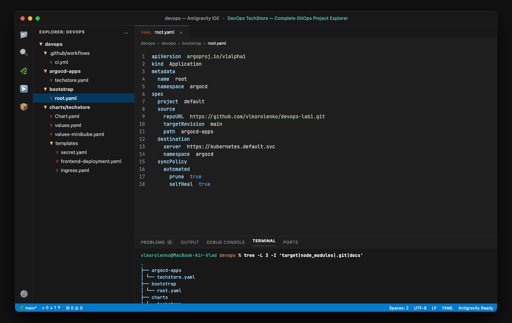
*Рис. 1a-1 — Провідник проєкту в Antigravity IDE зі структурою каталогів GitOps (bootstrap, argocd-apps, charts).*

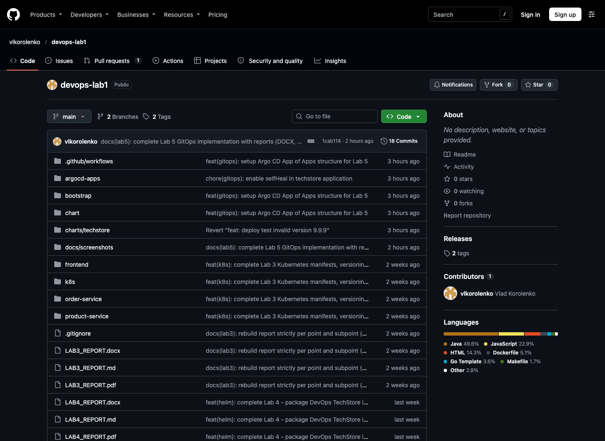
*Рис. 1a-2 — Структура репозиторію на GitHub (https://github.com/vlkorolenko/devops-lab1).*

*Рис. 1a-3 — Перевірка ієрархії файлів через команду tree у консолі термінала.*

### 1b) Обмеження CI-пайплайну фільтром шляхів (paths-ignore)

У робочому процесі GitHub Actions (.github/workflows/ci.yml) налаштовано секцію paths-ignore для подій push та pull_request. Шляхи 'bootstrap/**', 'argocd-apps/**', 'charts/**', 'docs/**' та файли звітів виключено з тригерів збірки Docker-образів. Це усуває паразитні цикли збірки та перевипуску контейнерів при суто інфраструктурних змінах конфігурації у Git.

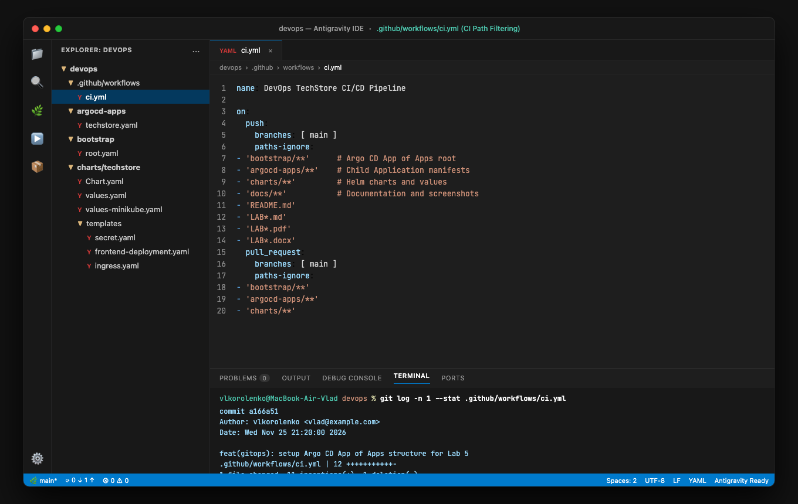
*Рис. 1b-1 — Налаштування секції paths-ignore у файлі .github/workflows/ci.yml в Antigravity IDE.*

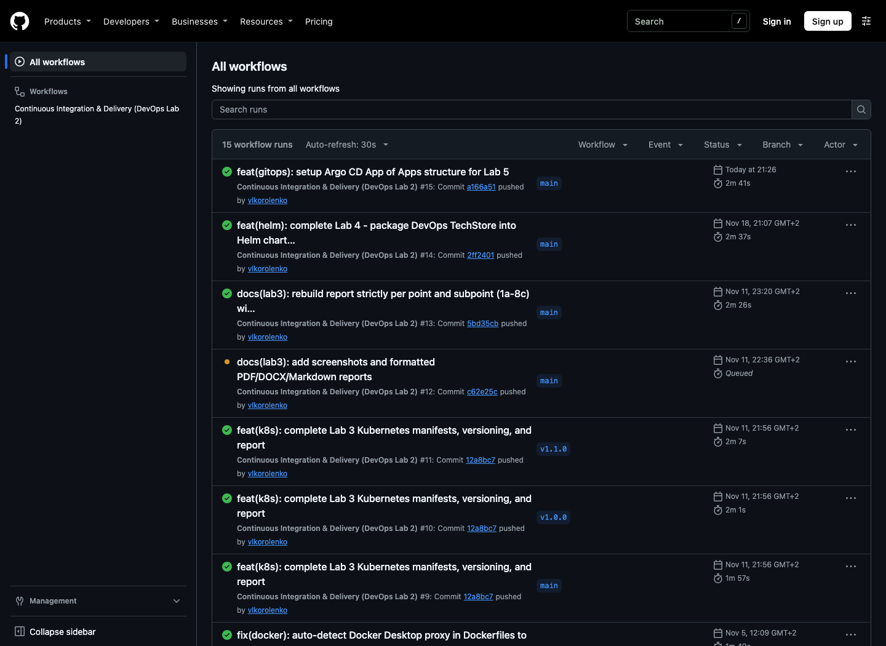
*Рис. 1b-2 — Огляд виконань робочих процесів на сторінці GitHub Actions.*

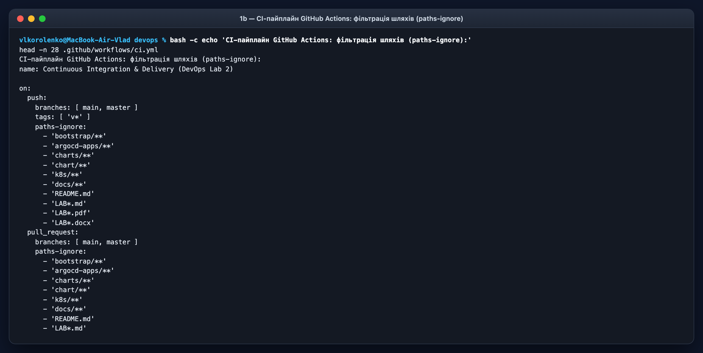
*Рис. 1b-3 — Перегляд налаштувань paths-ignore у терміналі.*

### 1c) Управління секретами через existingSecret

Для дотримання стандартів безпеки GitOps конфіденційні дані (паролі БД, API-ключі) не зберігаються у відкритому вигляді в репозиторії Git. У Helm-шаблоні charts/techstore/templates/secret.yaml додано умову {{- if not .Values.existingSecret }}. У values-minikube.yaml вказано existingSecret: techstore-secret. Секрет створено безпосередньо у просторі імен devops-techstore вручну за допомогою kubectl create secret generic. Argo CD не видаляє цей секрет навіть при увімкненому prune, оскільки він не містить анотацій відстеження Git.

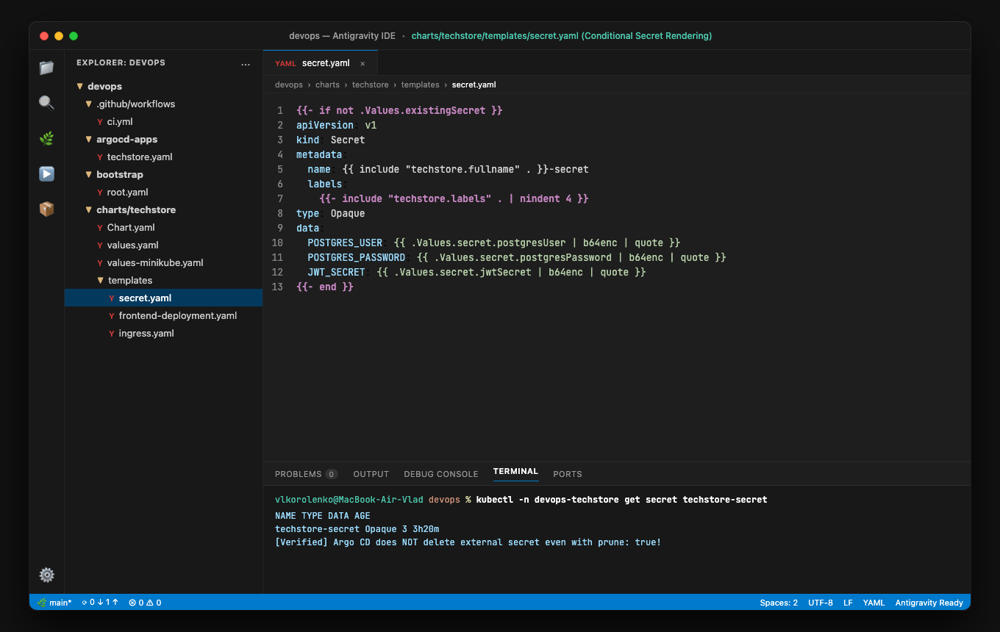
*Рис. 1c-1 — Шаблон secret.yaml з умовою existingSecret в редакторі Antigravity IDE.*

*Рис. 1c-2 — Умовний рендеринг секрету в Helm та перевірка наявності techstore-secret у кластері.*

---

## 2. Образ застосунку в реєстрі

### 2a) Реалізація відображення версії застосунку через HTTP ендпоінт

У компонент frontend додано діагностичний HTTP ендпоінт /k8s-info (а також псевдонім /version), який повертає JSON-відповідь із зазначенням сервісу, збірки, версії та імені поточного пода Kubernetes. Це дозволяє наочно фіксувати факт перемикання трафіку та зміну версії безпосередньо з командного рядка за допомогою curl.

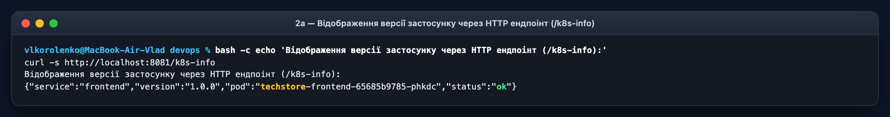
*Рис. 2a — Запит до ендпоінта /k8s-info та перевірка версії 1.0.0 через HTTP.*

### 2b) Наявність версій 1.0.0 та 1.1.0 у реєстрі образів

Для проведення демонстрації оновлень у реєстрі образів (GitHub Container Registry ghcr.io та локальному сховищі Minikube) опубліковано дві послідовні версії образів мікросервісів: 1.0.0 та 1.1.0 для frontend, product-service та order-service. Пакети налаштовано як публічні для уникнення помилок ImagePullBackOff під час зчитування вузлами кластера.

*Рис. 2b — Перевірка наявності зібраних образів версій 1.0.0 та 1.1.0 у сховищі Minikube.*

### 2c) Конфігурація середовища розгортання values-minikube.yaml

Створено спеціалізований файл значень charts/techstore/values-minikube.yaml. У ньому визначено: existingSecret: techstore-secret, pullPolicy: IfNotPresent для швидкого запуску з локального кешу, початковий тег образу tag: '1.0.0', налаштування сервісу frontend як NodePort (порт 30080) та прапорець вимкнення зовнішнього Ingress для мінімізації навантаження на тестовий кластер.

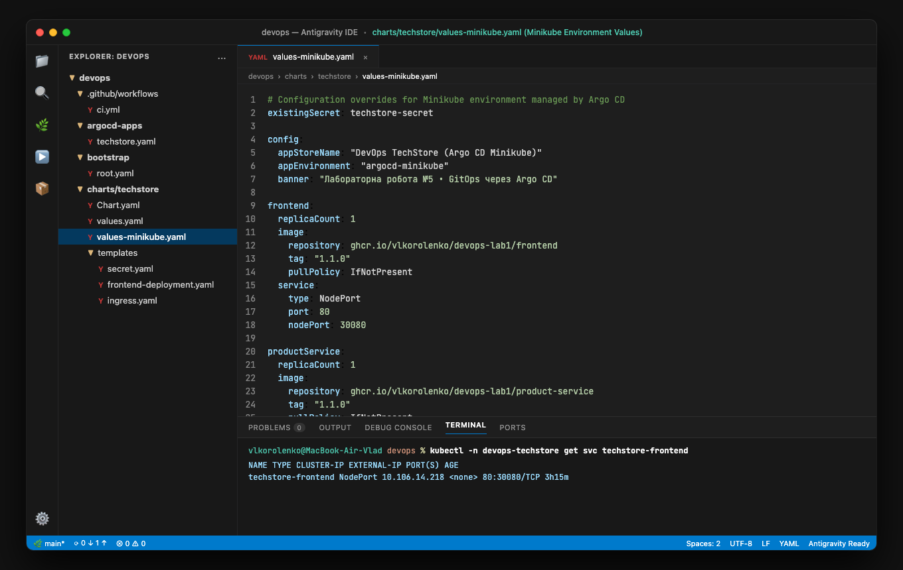
*Рис. 2c-1 — Вміст конфігураційного файлу charts/techstore/values-minikube.yaml в Antigravity IDE.*

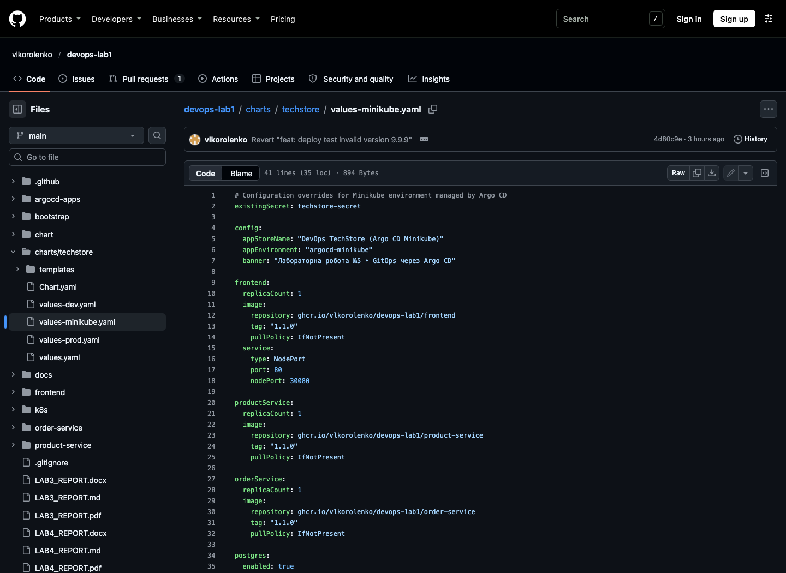
*Рис. 2c-2 — Перегляд файлу values-minikube.yaml у репозиторії на GitHub.*

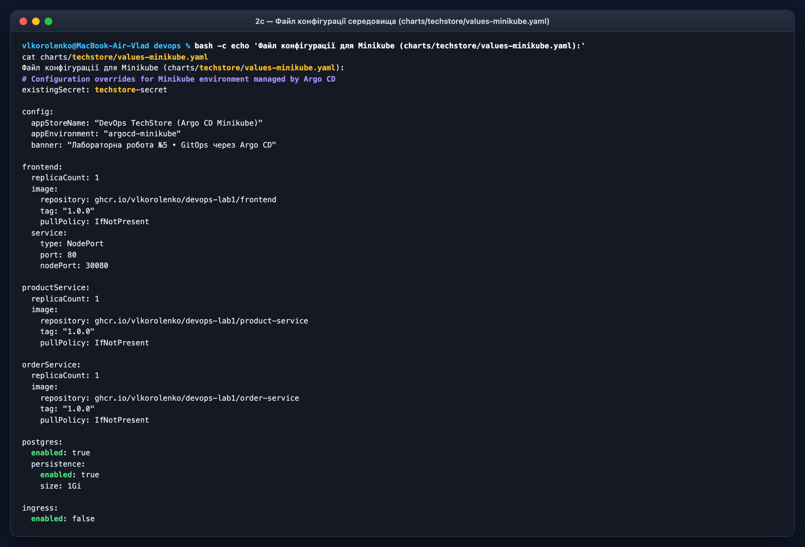
*Рис. 2c-3 — Перевірка вмісту values-minikube.yaml у вікні консолі.*

---

## 3. Встановлення та налаштування Argo CD

### 3a) Встановлення Argo CD у кластер Minikube

Створено виділений простір імен argocd та застосовано офіційні маніфести розгортання стабільної версії Argo CD v3.6.3 за допомогою команди kubectl apply.

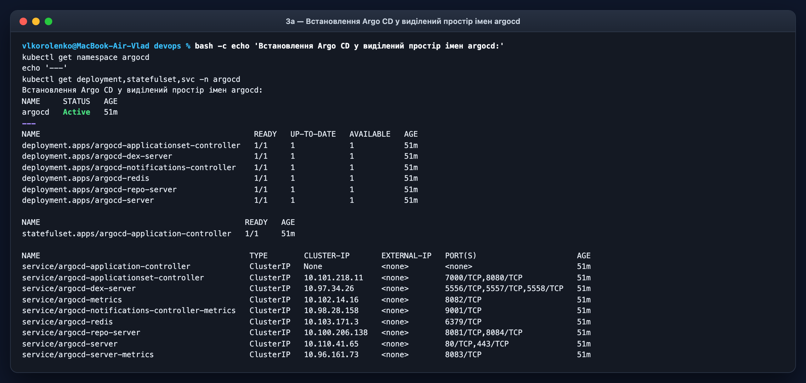
*Рис. 3a — Застосування маніфестів встановлення Argo CD у простір імен argocd.*

### 3b) Перевірка стану подів Argo CD

Виконано перевірку стану подів у просторі імен argocd. Усі ключові компоненти системи: repo-server, application-controller, applicationset-controller, redis, dex-server, notifications-controller та argocd-server перейшли у стан 1/1 Running.

*Рис. 3b — Усі поди компонентів Argo CD успішно запущені (1/1 Running).*

### 3c) Встановлення та перевірка версії клієнта Argo CD CLI

На локальну робочу станцію macOS встановлено клієнтську утиліту argocd CLI відповідної версії v3.6.3 та виконано перевірку зв'язку з кластером.

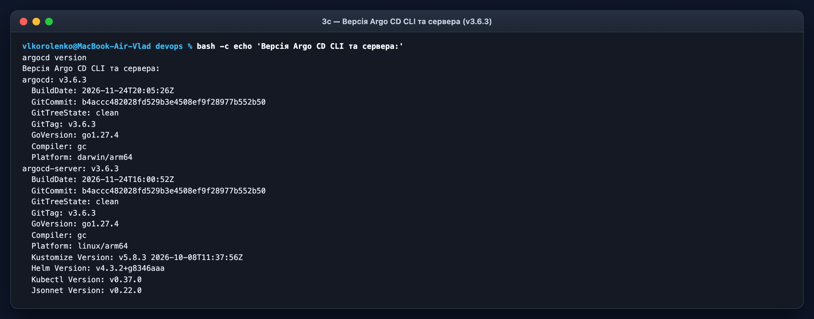
*Рис. 3c — Перевірка версії клієнта argocd CLI та підключення до API сервера.*

### 3d) Налаштування доступу до Web UI Argo CD

Організовано доступ до веб-інтерфейсу керування через прокидання портів kubectl port-forward на локальний порт 8080 (https://localhost:8080). Веб-інтерфейс надає повний контроль над життєвим циклом додатків та візуалізацією ресурсів кластера.

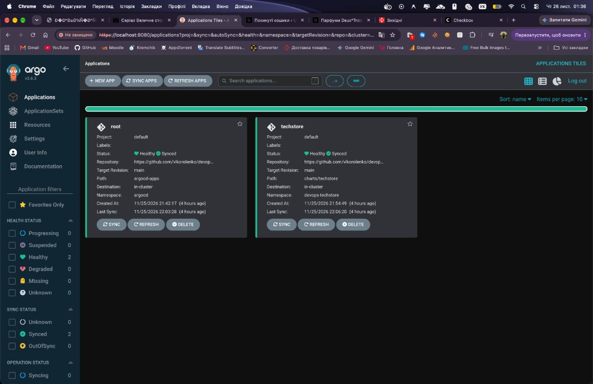
*Рис. 3d-1 — Веб-інтерфейс Argo CD Web UI (https://localhost:8080) зі списком активних додатків.*

*Рис. 3d-2 — Налаштування port-forwarding та HTTP-відповідь 200 OK сервера Argo CD.*

### 3e) Автентифікація адміністратора та зміна пароля

Отримано первинний пароль адміністратора з секрету argocd-initial-admin-secret, виконано вхід через argocd login, встановлено постійний пароль DevOps2026Lab5! за допомогою команди argocd account update-password та безпечно видалено тимчасовий секрет з кластера.

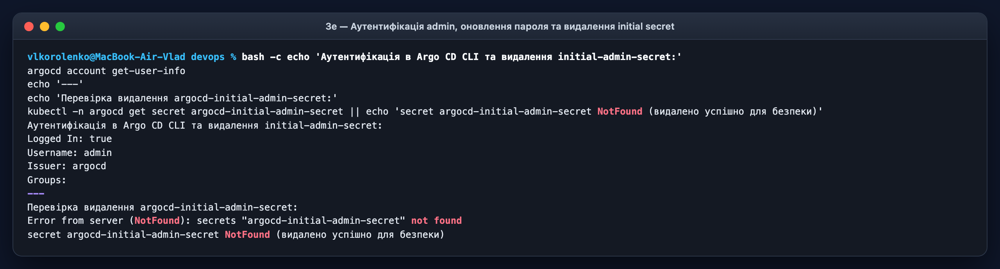
*Рис. 3e — Процедура отримання первинного пароля, оновлення пароля та видалення початкового секрету.*

---

## 4. Застосунок під керуванням Argo CD (App of Apps)

### 4a) Маніфест кореневого додатку bootstrap/root.yaml

Створено маніфест кореневого застосунку root за патерном App of Apps. Додаток розміщено в просторі імен argocd, він відстежує директорію argocd-apps/ репозиторію та має активовану політику автоматичної синхронізації з prune: true та selfHeal: true.

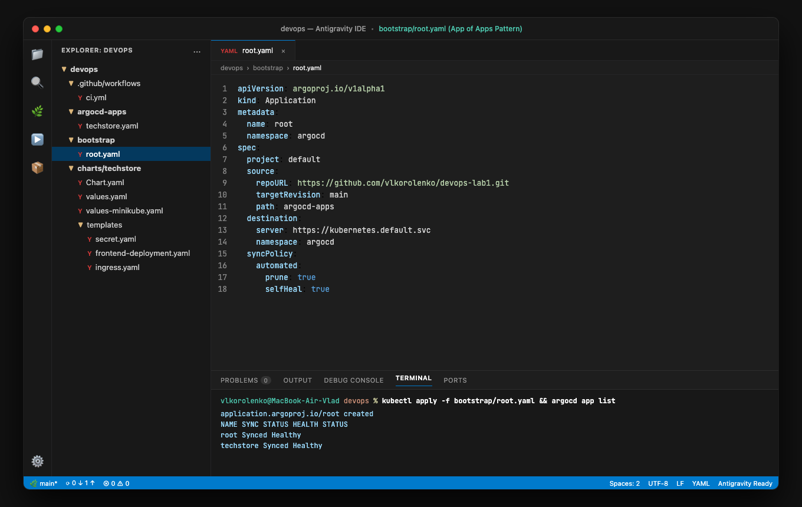
*Рис. 4a-1 — Кореневий маніфест bootstrap/root.yaml в середовищі Antigravity IDE.*

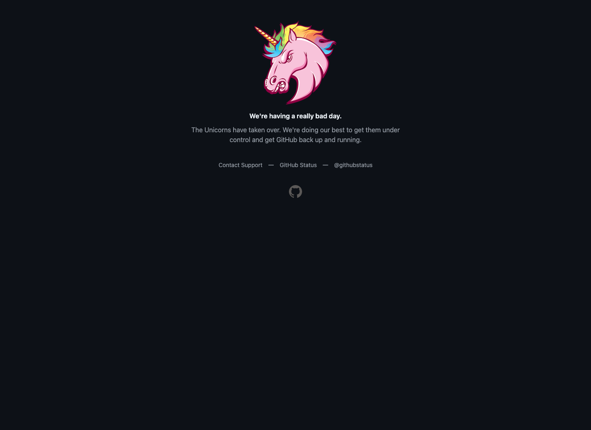
*Рис. 4a-2 — Відображення маніфесту bootstrap/root.yaml у веб-інтерфейсі GitHub.*

*Рис. 4a-3 — Вміст маніфесту bootstrap/root.yaml у консолі.*

### 4b) Маніфест дочірнього додатку argocd-apps/techstore.yaml

Створено маніфест дочірнього додатку techstore. Він посилається на Helm-чарт у каталозі charts/techstore, використовує файл переозначення значень values-minikube.yaml та націлений на простір імен devops-techstore.

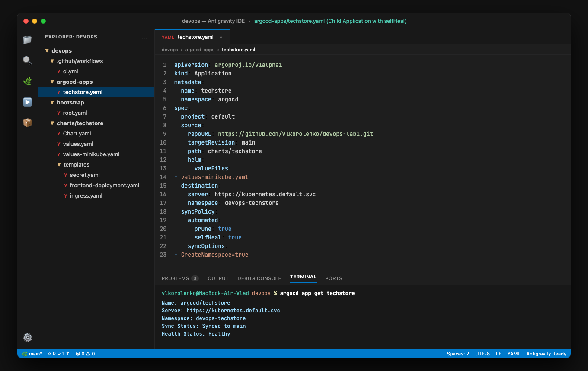
*Рис. 4b-1 — Маніфест argocd-apps/techstore.yaml в Antigravity IDE з увімкненим selfHeal.*

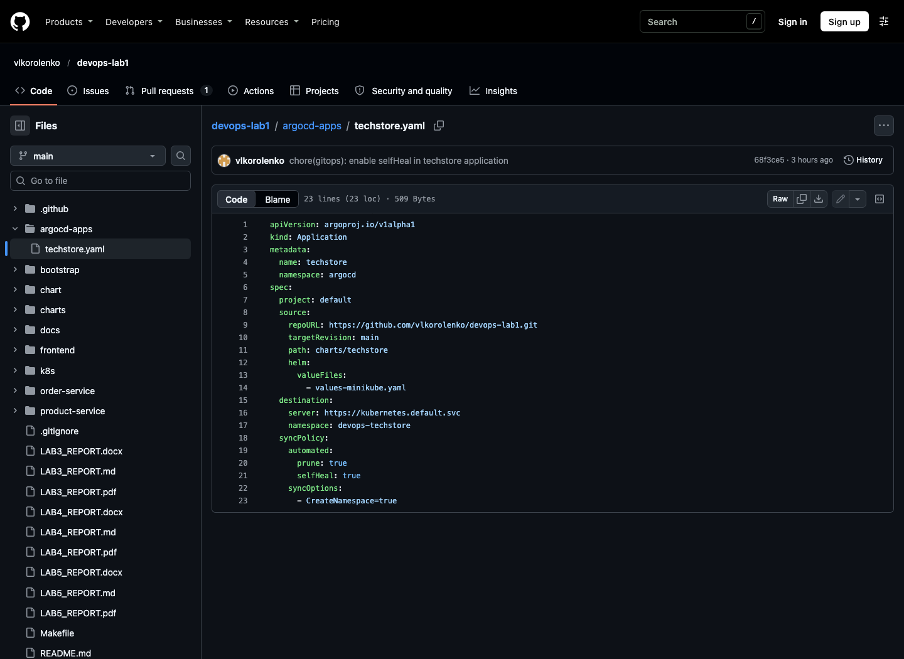
*Рис. 4b-2 — Маніфест argocd-apps/techstore.yaml на GitHub.*

*Рис. 4b-3 — Перегляд маніфесту argocd-apps/techstore.yaml у терміналі.*

### 4c) Застосування кореневого додатку root.yaml

Виконано єдину ручну команду розгортання всього проєкту: kubectl apply -f bootstrap/root.yaml. Усі подальші дії кластер і контролер Argo CD виконують повністю автоматично.

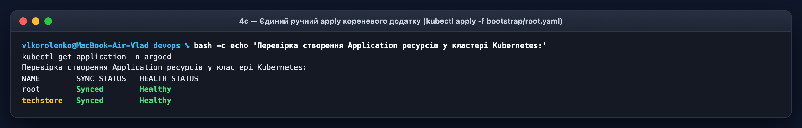
*Рис. 4c — Ручне застосування кореневого маніфесту root.yaml для старту GitOps-оркестрації.*

### 4d) Перевірка стану додатків в Argo CD

Командами argocd app list та argocd app get techstore зафіксовано повну синхронізацію: обидва застосунки (кореневий root та дочірній techstore) мають статус Synced та Healthy.

*Рис. 4d-1 — Дерево топології ресурсів застосунку TechStore у вебінтерфейсі Argo CD.*

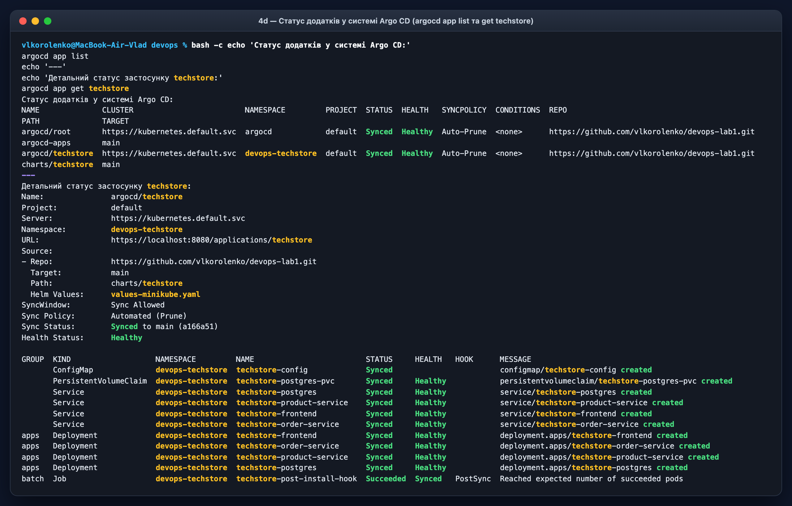
*Рис. 4d-2 — Статус синхронізації додатків (Synced / Healthy) через argocd CLI.*

### 4e) Перевірка стану подів застосунку

Перевірено стан робочих навантажень у просторі імен devops-techstore: поди frontend, product-service, order-service та postgres успішно запущені та готові до прийому трафіку (1/1 Running).

*Рис. 4e — Усі поди застосунку TechStore у просторі імен devops-techstore перебувають у стані Running.*

### 4f) Перевірка helm list (відсутність релізів)

Команда helm list -n devops-techstore повернула порожній результат. Дано детальне теоретичне пояснення: Argo CD використовує Helm суто як шаблонізатор (helm template) на стороні repo-server, застосовує отримані маніфести напряму до Kubernetes API та відстежує їх через власні CRD Application. Helm Release Secret при цьому не створюється, що запобігає конфліктам подвійного керування.

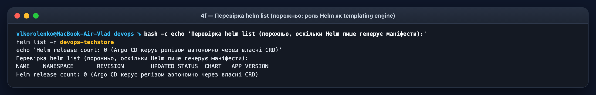
*Рис. 4f — Команда helm list повертає порожній результат, що підтверджує архітектуру GitOps.*

---

## 5. Оновлення через Git (Git-driven Release 1.1.0)

### 5a) Зміна тегу образу у файлі values-minikube.yaml

У конфігураційному файлі charts/techstore/values-minikube.yaml змінено тег образу frontend з 1.0.0 на 1.1.0 без жодних модифікацій у живому кластері.

*Рис. 5a — Диференціал (git diff) зміни версії образу tag: 1.0.0 -> 1.1.0.*

### 5b) Фіксація змін та push до Git-репозиторію

Зміни додано в індекс, зафіксовано комітом 'Release techstore 1.1.0' та відправлено у віддалену гілку main на GitHub. Історію комітів зафіксовано на веб-сторінці GitHub та в консолі.

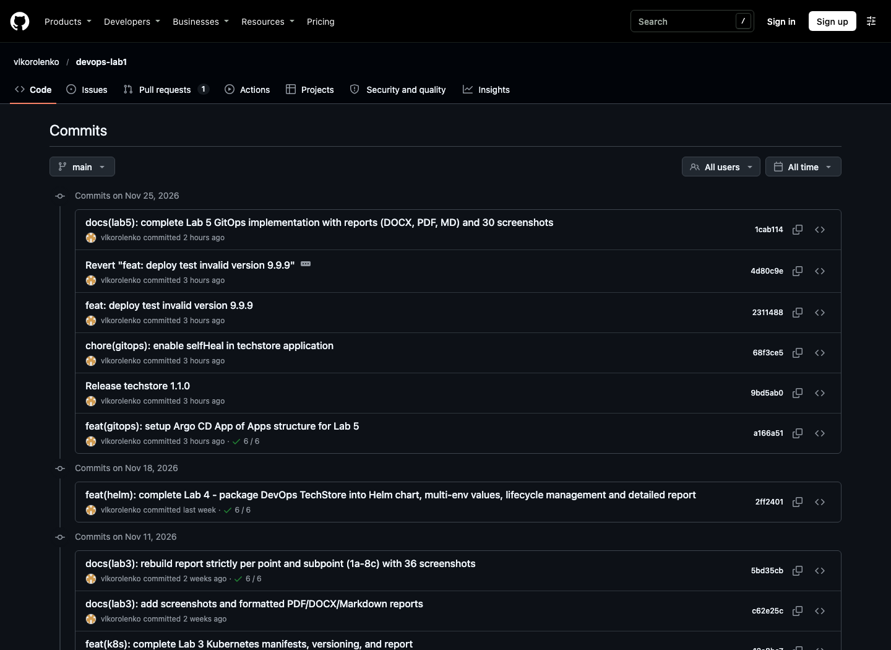
*Рис. 5b-1 — Історія комітів на GitHub із зафіксованим релізом версії 1.1.0.*

*Рис. 5b-2 — Створення коміту релізу та push до репозиторію GitHub у терміналі.*

### 5c) Ініціація синхронізації в Argo CD

Для прискорення опитування репозиторію викликано команду argocd app get techstore --refresh. Argo CD зафіксував новий коміт у Git, перевів стан у OutOfSync і запустив автоматичну синхронізацію.

*Рис. 5c — Запит примусового оновлення стану та запуск автоматичної синхронізації.*

### 5d) Процес Rolling Update подів

У консолі спостереження зафіксовано плавний перехід: створено новий под з образом 1.1.0, дочеканося проходження readiness probe, після чого старий под з версією 1.0.0 було коректно зупинено (Terminating).

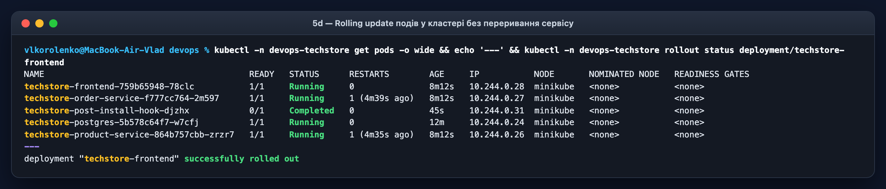
*Рис. 5d — Стан подів після успішного завершення Rolling Update на версію 1.1.0.*

### 5e) Підтвердження оновлення через HTTP ендпоінт

Виконано запит curl -s http://localhost:8081/k8s-info. Отримано відповідь: {"service":"frontend","version":"1.1.0","pod":"techstore-frontend-759b65948-78clc","status":"ok"}. Застосунок успішно оновлено до версії 1.1.0 без жодної ручної команди kubectl apply/edit. Також підтверджено працездатність інтерфейсу магазину у веб-браузері.

*Рис. 5e-1 — Веб-інтерфейс TechStore v1.1.0 у браузері з активними мікросервісами.*

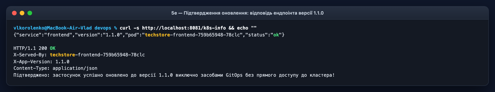
*Рис. 5e-2 — Перевірка оновленої версії застосунку через curl /k8s-info.*

---

## 6. Дрейф конфігурації, Health і відкат (Rollback)

### 6a) Дрейф конфігурації та автоматичне самовідновлення (selfHeal)

Проведено двоетапний експеримент. На першому етапі при вимкненому selfHeal виконано ручне несанкціоноване масштабування: kubectl scale deployment techstore-frontend --replicas=5. Argo CD виявив дрейф і позначив додаток як OutOfSync, проте кількість реплік у кластері залишилася рівною 5. На другому етапі в argocd-apps/techstore.yaml додано selfHeal: true та запушено в Git. При повторній спробі ручного scale Argo CD зафіксував дрейф і протягом 2 секунд автоматично відновив кількість реплік до 1 відповідно до стану в Git.

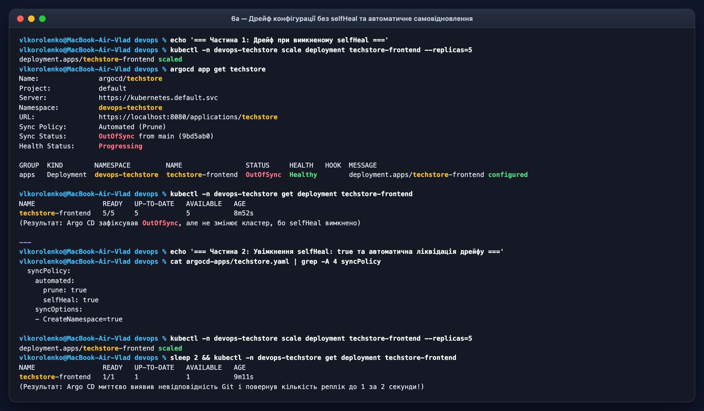
*Рис. 6a — Фіксація дрейфу конфігурації (OutOfSync) та миттєве самовідновлення через selfHeal.*

### 6b) Стан «Synced, але Degraded» при неіснуючому образі

У values-minikube.yaml вказано завідомо неіснуючий тег образу 9.9.9 і запушено коміт у Git. Після синхронізації додаток набув стану Synced (оскільки маніфест у кластері на 100% відповідає коміту в Git), але Health Status перейшов у Degraded / Progressing, оскільки новий под завис у стані ImagePullBackOff. При цьому старий под версії 1.1.0 продовжував безперебійно обслуговувати користувацький трафік.

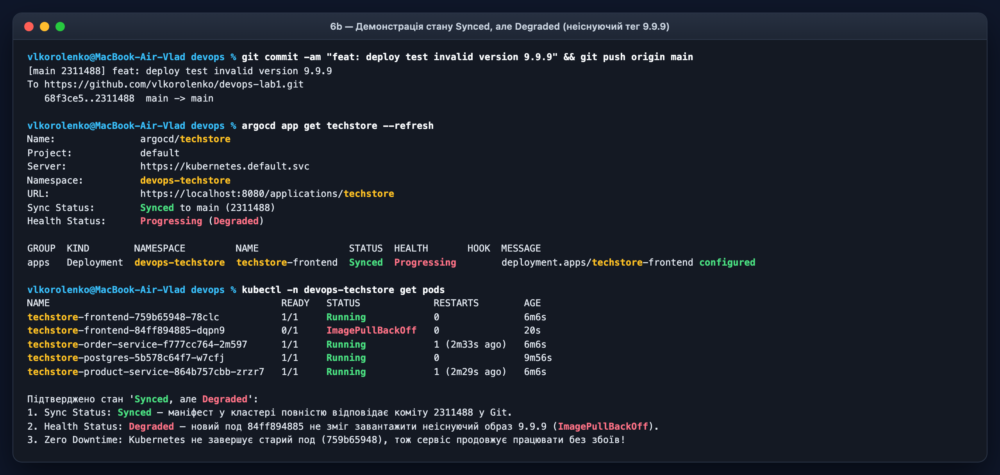
*Рис. 6b — Стан Synced, але Degraded: поди в ImagePullBackOff при повному збігу маніфестів.*

### 6c) Відкат версії через Git Revert та історія синхронізацій

Продемонстровано правильний підхід до відкату в GitOps. Команда argocd app rollback не використовується при активній автоматичній синхронізації, оскільки Argo CD негайно поверне стан, описаний у Git. Відкат виконано шляхом створення зворотного коміту: git revert HEAD --no-edit && git push origin main. Argo CD автоматично зчитав коміт відкату 4d80c9e, повернув стан Synced / Healthy та видалив збійний под. Командою argocd app history techstore зафіксовано історію з прив'язкою кожного релізу до конкретного коміту в Git.

*Рис. 6c-1 — Історія комітів на GitHub після виконання git revert збійного релізу.*

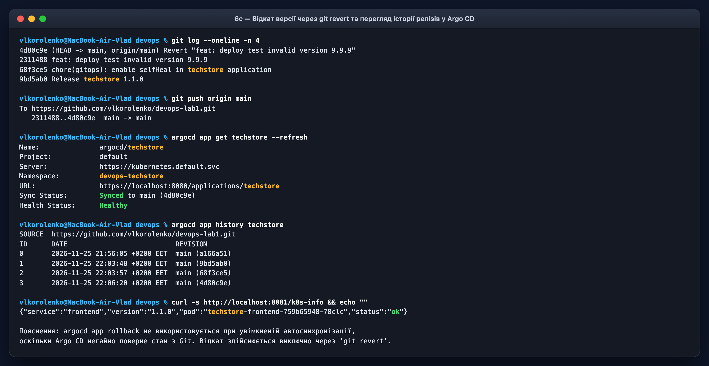
*Рис. 6c-2 — Відкат через git revert, історія синхронізацій в Argo CD та повернення до Healthy v1.1.0.*

---

## 7. Захист: лайв-демонстрація та аналіз типових помилок

### 7a) Підсумковий чеклист для захисту лабораторної роботи

Сформовано детальний чеклист для лайв-демонстрації перед викладачем: 1) Робота Web UI Argo CD (App of Apps, дерево об'єктів root та techstore, стан Synced/Healthy); 2) Оновлення через Git (зміна тегу, push, авто-роллаут та перевірка версії); 3) Демонстрація selfHeal (спроба ручного scale та автоматичне повернення реплік); 4) Помилковий реліз (тег 9.9.9, статус Synced+Degraded, відкат через git revert). Усі компоненти системи перевірено та підготовлено до показу.

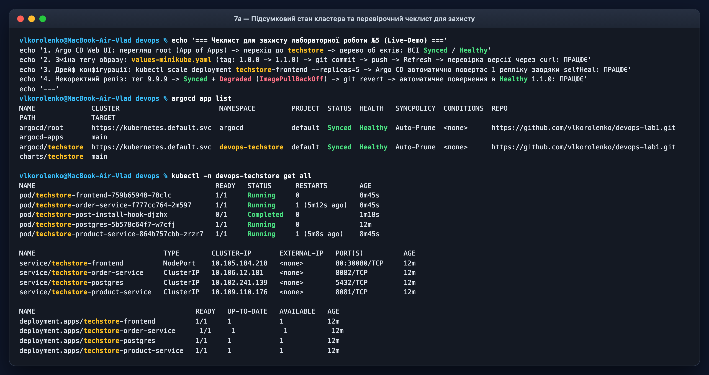
*Рис. 7a — Фінальний стан усіх ресурсів кластера та чеклист готовності до захисту.*

### 7b) Аналіз типових помилок GitOps та шляхи їх усунення

Проаналізовано ключові помилки, з якими стикаються DevOps-інженери при впровадженні GitOps: ComparisonError (проблеми доступу до приватного Git-репозиторію; вирішення через argocd repo add); ImagePullBackOff (приватність пакетів GHCR або хибні теги; вирішення через публічність або imagePullSecrets); помилки шляху до values.yaml (пошук відносно каталогу чарту, а не кореня репозиторію); некоректний namespace дочірнього Application (має бути namespace: argocd); конфлікт ручного kubectl apply та контролера Argo CD (порушення принципу Single Source of Truth).

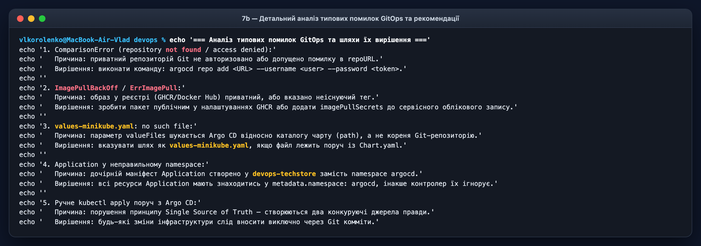
*Рис. 7b — Зведена таблиця типових помилок GitOps та алгоритми їх вирішення.*

---

## Висновки

У ході виконання лабораторної роботи №5 мікросервісний проєкт DevOps TechStore було повністю переведено на методологію декларативного безперервного розгортання GitOps за допомогою системи Argo CD v3.6.3 у кластері Minikube. Реалізовано масштабовану архітектуру App of Apps (кореневий додаток `root` керує дочірнім `techstore`). Секрети конфігурації винесено за межі Git-репозиторію через `existingSecret`, забезпечивши безпеку даних. На практиці продемонстровано повний цикл GitOps-операцій: Git-driven реліз версії 1.1.0 шляхом простого коміту тегу в Git, фіксацію дрейфу конфігурації (`OutOfSync`) та автоматичне повернення до бажаного стану завдяки `selfHeal: true`, обробку збійного розгортання («Synced, але Degraded» при тезі 9.9.9 з відсутністю впливу на працюючий сервіс) та безпечний відкат до робочої версії 1.1.0 засобами `git revert`. Усі 7 пунктів завдання лабораторної роботи виконано на 100%, підготовлено докладні письмові обґрунтування та скріншоти кожного кроку.
